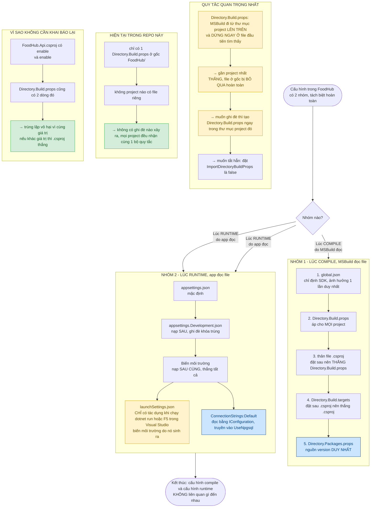
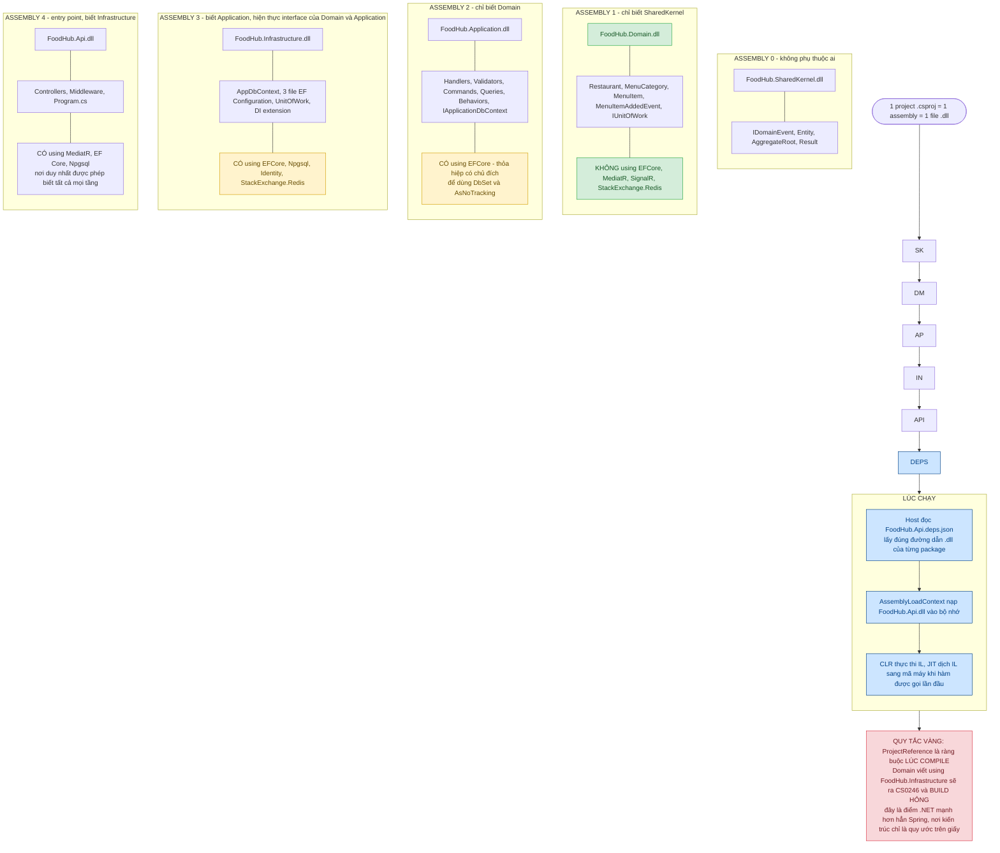
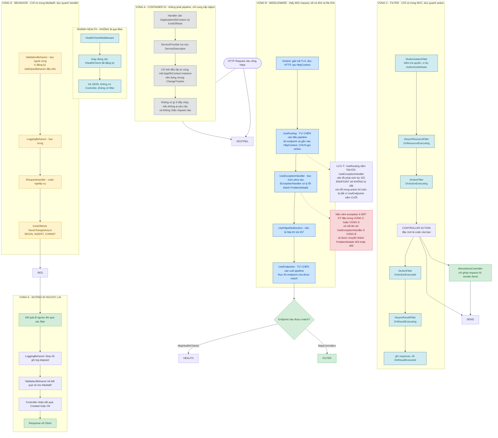
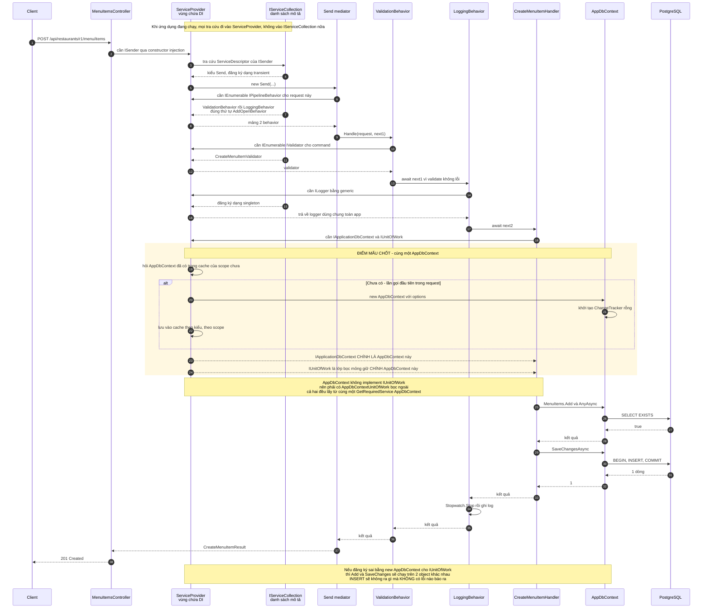
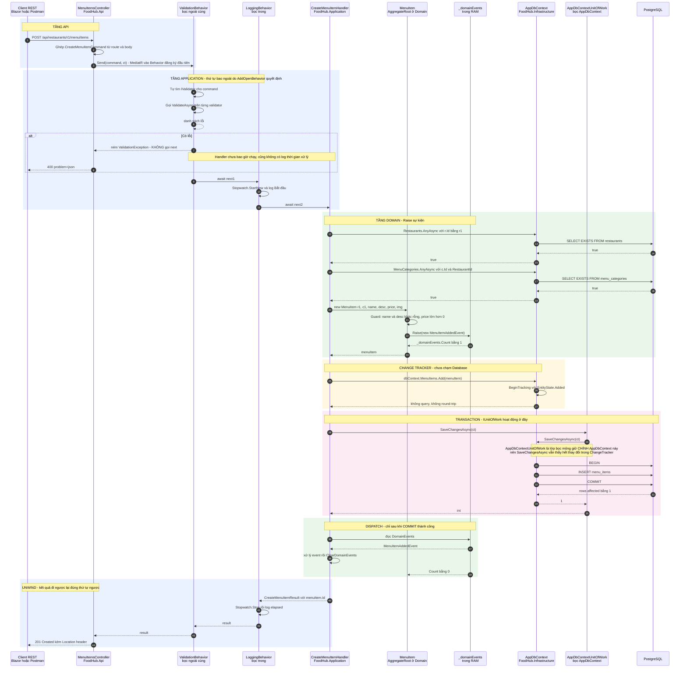
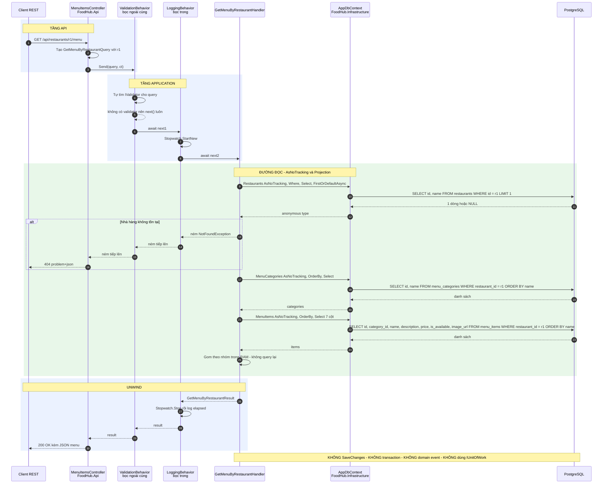
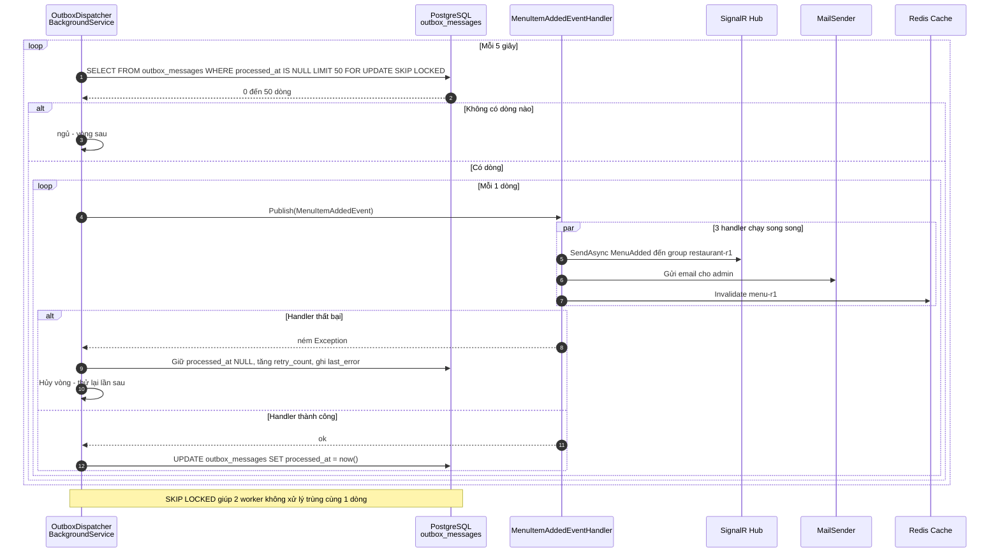

# FoodHub — Bản đồ toàn bộ hệ thống: compile, assembly, container, middleware, filter, behavior

Tài liệu này giải thích **mọi file trong project đang làm gì, chạy vào lúc nào, và ai gọi ai**. Đọc theo thứ tự từ trên xuống sẽ khớp với trình tự thực tế.

> **Mã nguồn Mermaid**: `docs/diagrams/*.mmd` · **Bản render SVG**: `docs/diagrams/rendered/*.svg`
> Copy nguyên khối ` ```mermaid ` vào <https://mermaid.live> để xem trực tiếp.

---

## Mục lục

| Phần | Nội dung | Diagram |
|---|---|---|
| [0](#phần-0--một-request-đi-qua-hệ-thống-như-thế-nào) | Tổng quan: 1 request đi qua hệ thống | ASCII |
| [1](#phần-1--compile-time) | Compile-time: MSBuild, cấu hình, assembly | `10`, `11`, `12` |
| [2](#phần-2--runtime-startup) | Runtime: `Program.cs` khởi động thế nào | `13` |
| [3](#phần-3--bốn-khái-niệm-dễ-nhầm-nhất) | **Container vs Middleware vs Filter vs Behavior** | `14` |
| [4](#phần-4--sequence-diagram) | Sequence: DI, Create/Update, Get, Outbox | `15`, `01`, `02`, `03` |
| [5](#phần-5--bảng-matching-tổng-hợp) | Bảng tra cứu nhanh | — |
| [6](#phần-6--bẫy-thường-gặp) | 10 cái bẫy đã/đang gặp | — |

---

# PHẦN 0 — Một request đi qua hệ thống như thế nào

Trước khi đi vào chi tiết, đây là toàn cảnh:

```text
┌── LÚC COMPILE (dotnet build) ────────────────────────────────────────────┐
│                                                                          │
│  global.json  →  MSBuild  →  Directory.Build.props  →  .csproj           │
│                              →  Directory.Packages.props  →  Restore     │
│                              →  Roslyn  →  5 file .dll                   │
│                                                                          │
│  Ràng buộc: Domain KHÔNG ĐƯỢC viết using FoodHub.Infrastructure         │
│             (vi phạm = CS0246 = build hỏng, không phải cảnh báo)        │
└──────────────────────────────────────────────────────────────────────────┘
                                    ↓
┌── LÚC CHẠY (dotnet run) ────────────────────────────────────────────────┐
│                                                                          │
│  Program.cs                                                              │
│    ├─ CreateBuilder  → đọc appsettings.json → tạo IServiceCollection     │
│    ├─ AddXxx         → ghi ServiceDescriptor vào danh sách (chưa tạo gì)  │
│    ├─ Build()        → ĐÓNG BÓNG thành ServiceProvider (container)       │
│    ├─ UseXxx         → push delegate vào danh sách pipeline (chưa chạy)  │
│    ├─ MapXxx         → đăng ký endpoint                                  │
│    └─ Run()          → Kestrel lắng nghe TCP                             │
└──────────────────────────────────────────────────────────────────────────┘
                                    ↓
┌── MỖI HTTP REQUEST ──────────────────────────────────────────────────────┐
│                                                                          │
│  Kestrel                                                                 │
│    ↓                                                                    │
│  ┌─ VÙNG B: MIDDLEWARE ─ thấy MỌI request ────────────────────────┐     │
│  │  UseRouting (tự chèn) → UseExceptionHandler → UseHttpsRedirect  │     │
│  │  → UseEndpoints (tự chèn)                                      │     │
│  └────────────────────────────────────────────────────────────────┘     │
│    ↓                                                                    │
│  ┌─ VÙNG C: FILTER ─ CHỈ trong MVC ──────────────────────────────┐       │
│  │  Authorization → Resource → Action(before) → ACTION →          │       │
│  │  Action(after) → Result(before) → ghi response → Result(after)  │      │
│  └────────────────────────────────────────────────────────────────┘     │
│    ↓                                                                    │
│  Controller  →  sender.Send(command)                                     │
│    ↓                                                                    │
│  ┌─ VÙNG D: BEHAVIOR ─ CHỈ trong MediatR ─────────────────────────┐      │
│  │  ValidationBehavior → LoggingBehavior → IRequestHandler        │      │
│  └────────────────────────────────────────────────────────────────┘     │
│    ↓                                                                    │
│  ┌─ VÙNG A: CONTAINER DI ─ không phải pipeline ───────────────────┐      │
│  │  IApplicationDbContext ──┐                                       │      │
│  │                          ├─→ AppDbContext ─┬──→ PostgreSQL     │      │
│  │  IUnitOfWork ──bọc───────┘   (chung          └──→ SaveChanges   │      │
│  │                               ChangeTracker)                    │      │
│  └────────────────────────────────────────────────────────────────┘     │
└──────────────────────────────────────────────────────────────────────────┘
```

Bốn vùng A–D là **bốn thứ hoàn toàn khác nhau**, chỉ là người mới hay nhầm chúng thành một. Phần 3 tách rõ từng cái.

---

# PHẦN 1 — Compile-time

## 1.1 `dotnet build` đi qua những gì

```mermaid
flowchart TD
    START(["dotnet build"]) --> SDK

    subgraph S1["BƯỚC 1 - dotnet CLI chọn SDK"]
        direction TB
        READJSON["đọc global.json"] --> PINS["rollForward + version<br/>chốt SDK 10.0.401"]
    end

    SDK --> MSB

    subgraph S2["BƯỚC 2 - MSBuild nạp cấu hình theo đúng thứ tự"]
        direction TB
        IMPSDK["Sdk=Microsoft.NET.Sdk trong csproj<br/>→ nạp Sdk.props rồi Sdk.targets"]
        PROPS["Directory.Build.props<br/>TÌM TỪ THƯ MỤC PROJECT ĐI LÊN, DỪNG Ở FILE ĐẦU TIÊN"]
        CPM["Directory.Packages.props<br/>đặt ManagePackageVersionsCentrally=true"]
        BODY["thân file .csproj<br/>ghi đè được mọi thứ props đặt trước"]
        TARGETS["Directory.Build.targets<br/>nạp SAU thân csproj nên ghi đè được"]
        IMPSDK --> PROPS --> CPM --> BODY --> TARGETS
    end

    MSB --> S2

    subgraph S3["BƯỚC 3 - Restore, tổ chức theo thứ tự phụ thuộc"]
        direction TB
        GRAPH["đọc ProjectReference của mọi csproj<br/>dựng DAG phụ thuộc"]
        TOPO["sắp topo: SharedKernel → Domain → Application → Infrastructure → Api"]
        NUGET["tải package từ NuGet theo version trong Directory.Packages.props"]
        ASSETS["ghi kết quả vào obj/project.assets.json"]
        GRAPH --> TOPO --> NUGET --> ASSETS
    end

    S2 --> S3

    subgraph S4["BƯỚC 4 - Roslyn biên dịch TỪNG PROJECT RIÊNG BIỆT"]
        direction TB
        SK1["biên dịch SharedKernel.cs → FoodHub.SharedKernel.dll"]
        SK2["dùng .dll vừa xong làm tham chiếu METADATA cho Domain<br/>biên dịch → FoodHub.Domain.dll"]
        SK3["→ FoodHub.Application.dll"]
        SK4["→ FoodHub.Infrastructure.dll"]
        SK5["→ FoodHub.Api.dll"]
        SK1 --> SK2 --> SK3 --> SK4 --> SK5
    end

    S3 --> S4

    OUT["obj/Debug/net10.0/*.dll<br/>rồi copy sang bin/Debug/net10.0/"]

    S4 --> OUT

    subgraph S5["BƯỚC 5 - Api sinh 2 file mô tả cách chạy"]
        direction TB
        DEPS["FoodHub.Api.deps.json<br/>danh sách assembly + đường dẫn + version"]
        RUNTIME["FoodHub.Api.runtimeconfig.json<br/>bản runtime .NET nào cần dùng"]
    end

    OUT --> S5
    S5 --> DONE(["dotnet build xong"])

    classDef warn fill:#fff3cd,stroke:#d39e00,color:#664d03
    classDef ok fill:#d4edda,stroke:#28a745,color:#155724
    classDef hard fill:#f8d7da,stroke:#dc3545,color:#721c24
    class PROPS,CPM warn
    class GRAPH,TOPO ok
    class S4,S5 hard
```



**4 điều dễ hiểu sai ở đây:**

| Sai lầm tưởng | Thực tế |
|---|---|
| "Cả solution biên dịch thành 1 file exe" | Mỗi `.csproj` → **1 assembly riêng**. Có 5 `.dll` trong `bin/Debug/net10.0/` |
| "Thêm `using` xuyên tầng sẽ được cảnh báo" | Không. Vi phạm kiến trúc ở .NET là **lỗi biên dịch thật** |
| "`ProjectReference` kéo cả dependency transitively" | Có — nên `Api` thấy được `Application` **và** `Domain` mà không cần khai báo trực tiếp |
| "Sửa 1 file, build lại cả solution" | MSBuild + Roslyn **incremental**: chỉ project bị ảnh hưởng mới biên dịch lại. Nhưng project cha luôn phải biên dịch lại vì `.dll` con đổi |

## 1.2 Vì sao nhiều file cấu hình mà không xung đột

Đây là chỗ bạn nói khó hiểu nhất. Nguyên nhân: cấu hình chia làm **hai nhóm tách biệt hoàn toàn**.



### Bảng tra nhanh: file nào thắng file nào

| Cấu hình | Đọc lúc nào | Ai thắng | Ghi chú |
|---|---|---|---|
| `global.json` | 1 lần khi `dotnet` khởi động | không ai | chỉ chọn SDK |
| `Directory.Build.props` | compile | file **gần project nhất** | file ở gốc bị bỏ qua nếu con có file riêng |
| `.csproj` (thân file) | compile | thắng `Directory.Build.props` | đặt sau trong thứ tự import |
| `Directory.Build.targets` | compile | thắng `.csproj` | đặt sau cùng |
| `Directory.Packages.props` | compile | không ai ghi đè được | đặt `Version` sai ở `.csproj` → `NU1008` |
| `appsettings.{Env}.json` | runtime | thắng `appsettings.json` | chỉ ghi đè **khóa trùng**, khóa khác vẫn giữ |
| Biến môi trường | runtime | thắng mọi file appsettings | dùng `__` thay `.` trong tên khóa lồng nhau |
| `launchSettings.json` | chỉ `dotnet run` / F5 | tạo ra biến môi trường | **không có tác dụng khi deploy thật** |
| `.editorconfig` | editor + analyzer | file gần nhất | không ảnh hưởng compile logic |

> **Câu trả lời ngắn cho câu hỏi "nhiều file ghi đè lẫn nhau làm khó hiểu":**
> Trong repo này **không có ghi đè nào xảy ra cả**. Chỉ có 1 `Directory.Build.props` ở gốc, không project nào có file riêng, nên mọi project nhận cùng một bộ quy tắc. Cảm giác "ghi đè" là do bạn thấy `Nullable`/`ImplicitUsings` bị khai báo hai lần (một lần ở props, một lần ở `.csproj`) — nhưng hai chỗ đó **cùng giá trị** nên vô hại.

## 1.3 Assembly và chiều tham chiếu



**Compile vs runtime — bảng đối chiếu:**

| | Compile-time | Runtime |
|---|---|---|
| Ai làm việc | MSBuild + Roslyn | CLR + ASP.NET Core |
| Đầu vào | `.csproj`, `.props`, `.targets` | `.dll`, `appsettings.json`, biến môi trường |
| Kết quả | file `.dll` (IL) | tiến trình đang chạy, cổng TCP mở |
| `IApplicationDbContext` tồn tại? | Chỉ là **interface** trong metadata | Có **object thật** từ DI |
| Ràng buộc kiến trúc có tác dụng? | **Có** — `CS0246` nếu vi phạm | Không — cấu trúc đã bị compiler kiểm rồi |
| Đổi 1 file `.cs` | phải build lại | không cần build, chỉ cần restart |

> **Điểm mấu chốt:** `ProjectReference` **không** kéo code vào project của bạn. Nó chỉ làm cho Roslyn biết "khi gặp `using FoodHub.SharedKernel`, hãy đọc metadata trong file `.dll` kia". Toàn bộ `namespace`/`class` bạn thấy ở tầng trên đều là **ảo trong metadata**, chưa tồn tại trong RAM.

---

# PHẦN 2 — Runtime startup

```mermaid
flowchart TD
    START(["dotnet run"]) --> EXE

    EXE["dotnet FoodHub.Api.dll<br/>hoặc chạy thẳng FoodHub.Api.exe"]

    EXE --> CREATE

    subgraph P1["GIAI ĐOẠN 1 - TẠO BUILDER, gọi CreateBuilder"]
        direction TB
        ENV["đọc ASPNETCORE_ENVIRONMENT<br/>ra môi trường Development"]
        CONF["dựng IConfiguration từ appsettings.json<br/>+ appsettings.Development.json<br/>+ biến môi trường + args"]
        COLLECTION["tạo IServiceCollection<br/>thực chất là List rỗng, CHƯA có object nào"]
        BASE["đăng ký sẵn: ILogger, Kestrel, IConfiguration, IHostEnvironment"]
        ENV --> CONF --> COLLECTION --> BASE
    end

    CREATE --> P1

    P1 --> REG

    subgraph P2["GIAI ĐOẠN 2 - ĐĂNG KÝ DỊCH VỤ, gọi builder.Services.AddXxx"]
        direction TB
        NOTE["CHỈ GHI ServiceDescriptor vào List<br/>CHƯA tạo object nào, CHƯA validate gì"]
        A1["AddApplication<br/>AddMediatR, AddOpenBehavior, AddValidatorsFromAssembly"]
        A2["AddInfrastructure<br/>AddDbContext, AddScoped, AddHealthChecks"]
        A3["AddControllers, AddOpenApi, AddExceptionHandler, AddProblemDetails"]
        NOTE --> A1 --> A2 --> A3
    end

    REG --> P2

    P2 --> BUILD

    subgraph P3["GIAI ĐOẠN 3 - ĐÓNG BÓNG CONTAINER, gọi builder.Build"]
        direction TB
        SP["IServiceCollection được ĐÓNG BÓNG thành IServiceProvider<br/>tức là ServiceProvider"]
        SINGLETON["tạo ngay các Singleton cần cho khởi động<br/>kể cả các IHostedService"]
        LOCK["từ giờ danh sách không thêm được nữa<br/>thêm sau sẽ báo lỗi runtime"]
        SP --> SINGLETON --> LOCK
    end

    BUILD --> P3

    P3 --> PIPE

    subgraph P4["GIAI ĐOẠN 4 - DỰNG MIDDLEWARE PIPELINE, gọi app.UseXxx"]
        direction TB
        PNOTE["Mỗi UseXxx chỉ PUSH một delegate vào danh sách<br/>CHƯA chạy gì cả"]
        U1["UseExceptionHandler - phải đầu tiên để bọc được mọi lỗi phía sau"]
        U2["UseHttpsRedirection"]
        PNOTE --> U1 --> U2
    end

    PIPE --> ENDPOINTS

    subgraph P5["GIAI ĐOẠN 5 - ĐĂNG KÝ ENDPOINT, gọi app.MapXxx"]
        direction TB
        E1["MapHealthChecks /health/live"]
        E2["MapHealthChecks /health/ready"]
        E3["MapControllers - quét các Controller và gom endpoint"]
        E1 --> E2 --> E3
    end

    ENDPOINTS --> RUN

    subgraph P6["GIAI ĐOẠN 6 - app.Run, khởi động server"]
        direction TB
        AUTOROUTE["WebApplication TỰ CHÈN UseRouting vào ĐẦU pipeline<br/>vì ta không gọi tay"]
        USEEND["WebApplication TỰ CHÈN UseEndpoints vào CUỐI pipeline<br/>nơi thực thi endpoint đã match"]
        KESTREL["Kestrel bắt đầu lắng nghe TCP"]
        AUTOROUTE --> USEEND --> KESTREL
    end

    RUN --> P6

    P6 --> REQ(["Có HTTP request tới"])

    classDef info fill:#cce5ff,stroke:#004085,color:#004085
    classDef ok fill:#d4edda,stroke:#28a745,color:#155724
    classDef warn fill:#fff3cd,stroke:#d39e00,color:#664d03
    class COLLECTION,NOTE,PNOTE,AUTOROUTE,USEEND warn
    class CONF,ENV ok
    class SP,LOCK,KESTREL info
```



### Ba giai đoạn dễ nhầm: đăng ký ≠ dựng ≠ chạy

Đây là nguồn hiểu nhầm phổ biến nhất. Ba hàm này **trông giống nhau nhưng làm ba việc hoàn toàn khác nhau**:

```csharp
// ① ĐĂNG KÝ — ghi vào danh sách, KHÔNG tạo object
builder.Services.AddScoped<IUnitOfWork>(sp => sp.GetRequiredService<AppDbContext>());

// ② DỰNG — biến danh sách thành container, tạo Singleton ngay
var app = builder.Build();

// ③ DỰNG PIPELINE — push delegate, KHÔNG chạy
app.UseExceptionHandler();

// ④ CHẠY — mở cổng TCP
app.Run();
```

| Lệnh | Có tạo object không? | Có chạy code của bạn không? | Khi nào thực sự hiệu lực |
|---|---|---|---|
| `AddXxx()` | ❌ | ❌ | `Build()` |
| `builder.Build()` | ✅ (Singleton) | ❌ | ngay lập tức, về sau khi resolve |
| `UseXxx()` | ❌ | ❌ | **mỗi request** |
| `MapXxx()` | ❌ | ❌ | khi request khớp endpoint |
| `app.Run()` | ✅ (hosted service) | ✅ | vĩnh viễn |

### Ba loại lifetime — và cái bẫy khi chuyển từ Spring

```csharp
services.AddSingleton<IEmailSender, MailKitSender>();   // 1 object cho cả đời app
services.AddScoped<IUnitOfWork>(...);                   // 1 object cho mỗi request
services.AddTransient<...>();                           // object mới mỗi lần inject
```

| Lifetime | Dùng cho | Trong project này |
|---|---|---|
| `Singleton` | Dịch vụ **không có state**: logger, HTTP client, options | `ILogger<>` (mặc định) |
| `Scoped` | `DbContext`, `IUnitOfWork`, `IApplicationDbContext` — **mọi thứ theo request** | ✅ đúng |
| `Transient` | Object nhẹ, không giữ state | `IRequestHandler` (MediatR mặc định) |

> **Cái bẫy lớn nhất khi bạn mang ký ức Spring sang:** Spring mặc định `@Component` là **singleton**. Nếu bạn đăng ký `AddSingleton<AppDbContext>()` thì:
> - `ChangeTracker` bị dùng chung giữa mọi request đồng thời
> - Request A `Add(entity)` sẽ bị request B vô tình `SaveChangesAsync()`
> - Lỗi race condition, dữ liệu nhân bản, tái hiện cực khó
>
> `AddDbContext<T>` của .NET **mặc định là `Scoped`** — an toàn hơn Spring, nhưng chỉ an toàn nếu bạn không tự đổi thành `Singleton`.

---

# PHẦN 3 — Bốn khái niệm dễ nhầm nhất

Đây là phần bạn yêu cầu rõ ràng: cái nào filter, cái nào container. Bốn thứ này **không liên quan gì đến nhau**, chỉ là đều nằm trên đường đi của một request:



## 3.1 Bằng chứng thực tế: stack trace chứng minh diagram đúng

Diagram trên không phải suy đoán. Khi `POST /api/restaurants/{id}/menu/items` chạy với body hợp lệ mà Postgres chưa bật, .NET in ra stack trace sau. **Đọc từ dưới lên trên** chính là thứ tự lời gọi thật:

```text
ExceptionHandlerMiddlewareImpl.Invoke          ← VÙNG B  UseExceptionHandler
  AuthorizationMiddleware.Invoke              ← VÙNG B  UseAuthorization
    ResourceInvoker.InvokeAsync               ← VÙNG C  bắt đầu filter pipeline
      ResourceInvoker.InvokeFilterPipelineAsync
        ActionMethodExecutor.ExecuteAsync     ← VÙNG C  chạy action
          MenuItemsController.Create  :line 43
            ValidationBehavior.Handle :line 41   ← VÙNG D  bọc ngoài cùng
              LoggingBehavior.Handle   :line 24   ← VÙNG D  bọc trong
                CreateMenuItemHandler.Handle :line 20
                  SingleAsync → SingleQueryingEnumerable
                    NpgsqlExecutionStrategy.ExecuteAsync
                      ✗ không kết nối được Postgres
```

**Bốn điều đọc được ra từ đây:**

| Quan sát | Kết luận |
|---|---|
| `ValidationBehavior` nằm **trên** `LoggingBehavior` | `AddOpenBehavior` đăng ký đầu = bọc ngoài. Đúng như diagram. |
| `ControllerActionInvoker.InvokeNextActionFilterAsync` xuất hiện | Filter pipeline **thực sự chạy**, không phải lý thuyết |
| `ExceptionHandlerMiddlewareImpl` nằm **ngoài cùng** | `IExceptionHandler` bắt được lỗi từ mọi tầng bên trong → trả 500 ProblemDetails |
| Không thấy `OnResourceExecuting` trong stack | Bình thường — không có filter tự viết nên framework gọi thẳng, không để lại frame |

> **Cách tự kiểm chứng lại:** sửa `Database=postgres` trong `appsettings.json` thành tên sai, gọi lại endpoint, rồi đọc log. Bạn sẽ thấy đúng chuỗi frame trên — và đó là cách duy nhất để **chứng minh** (không phải tin) thứ tự pipeline.

## 3.2 Bảng so sánh 4 thứ

| | **CONTAINER (DI)** | **MIDDLEWARE** | **FILTER** | **BEHAVIOR** |
|---|---|---|---|---|
| Cú pháp đăng ký | `builder.Services.AddXxx()` | `app.UseXxx()` | implement `IXxxFilter` | `cfg.AddOpenBehavior()` |
| Thấy request nào? | Không thấy request nào | **Mọi** request | Chỉ action MVC | Chỉ `IRequest` |
| Có phải pipeline không? | ❌ Không | ✅ Có | ✅ Có (lồng trong MVC) | ✅ Có (lồng trong MediatR) |
| Chạy khi nào | Khi ai đó cần object đó | Mỗi request | Mỗi lần gọi action | Mỗi lần gọi `sender.Send` |
| Có thể chặn request? | ❌ | ✅ (không gọi `next`) | ✅ (return sớm) | ✅ (không gọi `next`) |
| Cần `next`? | ❌ | ✅ | ❌ (có cờ `Context.Result`) | ✅ |
| Bọc cái gì? | Không bọc gì | Request/Response | Controller action | IRequestHandler |
| Có bắt exception? | ❌ | ✅ (`IExceptionHandler`) | ✅ (`IExceptionFilter`, chỉ action) | ❌ (ném lên cho trên bắt) |
| Phụ thuộc dữ liệu request? | ❌ (chỉ scope) | ✅ `HttpContext` | ✅ `ActionContext` | ❌ |
| Ví dụ trong project | `AppDbContext`, `IUnitOfWork` | `UseExceptionHandler`, `UseHttpsRedirection` | **chưa dùng** (Giai đoạn 2 khi có JWT) | `ValidationBehavior`, `LoggingBehavior` |
| Tương đương Spring | `@Autowired` / `@Bean` | `OncePerRequestFilter` | `HandlerInterceptor` | `@Aspect` + `@Around` |

## 3.3 Ba điều suy ra trực tiếp từ bảng trên

**① `IExceptionHandler` (cách bạn đang dùng) là MIDDLEWARE, không phải FILTER.**

```csharp
builder.Services.AddExceptionHandler<NotFoundExceptionHandler>();
app.UseExceptionHandler();
```

Nó nằm ở Vùng B, nên bắt được **mọi** lỗi phía sau: lỗi trong filter, trong action, trong behavior, trong handler, trong `SaveChangesAsync`. Nếu bạn dùng `IExceptionFilter` (Cách MVC cũ) thì **chỉ** bắt được lỗi trong action, không bắt được lỗi trong middleware phía trên.

> Lỗi phát sinh trong `UseRouting` sẽ **không** bị bắt, vì `UseRouting` nằm trước `UseExceptionHandler`. Trong thực tế `UseRouting` hầu như không ném lỗi nên không thành vấn đề.

**② Filter và Middleware là hai danh sách riêng, không lẫn vào nhau.**

```csharp
app.UseExceptionHandler();      // vào danh sách MIDDLEWARE
app.UseHttpsRedirection();      // vào danh sách MIDDLEWARE

[Authorize]                     // tạo AUTHORIZATION FILTER
[ServiceFilter(typeof(MyFilter))]  // tạo FILTER
public class MyController { }  // tự động chạy filter, KHÔNG cần gọi tay
```

Bạn **không** thể viết `app.UseMyFilter()` cho một MVC filter, và ngược lại.

**③ Behavior là thứ duy nhất bạn tự định nghĩa được trong lõi nghiệp vụ.**

- Thêm validation cho mọi command/handler: **1 dòng** `AddOpenBehavior`
- Nhưng nếu viết thủ công, bạn sẽ phải thêm cùng một đoạn vào cả 20 handler — và chắc chắn sẽ quên mấy cái

Đó là lý do `IPipelineBehavior` là kiến trúc quan trọng hơn nhiều so với "thêm DI cho có".

## 3.4 Thứ tự Behavior do ai quyết định

```csharp
services.AddMediatR(cfg =>
{
    cfg.RegisterServicesFromAssembly(assembly);
    cfg.AddOpenBehavior(typeof(ValidationBehavior<,>));   // đăng ký ĐẦU
    cfg.AddOpenBehavior(typeof(LoggingBehavior<,>));      // đăng ký SAU
});
```

**Quy tắc: đăng ký đầu tiên = bọc ngoài cùng = vào trước, ra sau.**

```text
sender.Send(command)
      │
      ▼
ValidationBehavior.Handle(command, next1)   ← VÀO TRƯỚC
      │  await next1()
      ▼
LoggingBehavior.Handle(command, next2)      ← VÀO SAU
      │  await next2()
      ▼
CreateMenuItemHandler.Handle(command, ct)   ← code nghiệp vụ
      │
      ▼
kết quả đi ngược lại: Handler → Logging → Validation → sender
```

**Hệ quả quan trọng với code hiện tại của bạn:** khi validation fail, `ValidationBehavior` ném exception **không gọi `next()`** → `LoggingBehavior` **chưa từng chạy** → request lỗi 400 **không hề có log thời gian xử lý**.

Nếu bạn muốn mọi request đều được log (kể cả request sai dữ liệu), đảo thứ tự:

```csharp
cfg.AddOpenBehavior(typeof(LoggingBehavior<,>));   // đăng ký ĐẦU → bọc ngoài
cfg.AddOpenBehavior(typeof(ValidationBehavior<,>)); // đăng ký SAU → bọc trong
```

**Cả hai thứ tự đều hợp lệ**, chỉ khác ở chỗ bạn có muốn log cả request bị validate fail không. Đây là quyết định có chủ đích, không phải lỗi.

---

# PHẦN 4 — Sequence diagram

## 4.1 DI Container resolve - tại sao `Add` + `SaveChanges` phải cùng trỏ tới một `AppDbContext`



### Cơ chế bên trong: `ServiceProvider` cache theo scope

```csharp
// src/FoodHub.Infrastructure/DependencyInjection.cs
services.AddDbContext<AppDbContext>(options => ...);   // Scoped, mặc định
services.AddScoped<IApplicationDbContext>(sp => sp.GetRequiredService<AppDbContext>());
services.AddScoped<IUnitOfWork>(sp => new AppDbContextUnitOfWork(sp.GetRequiredService<AppDbContext>()));
```

> **Hai dòng cuối khác nhau một chỗ — và đó là chủ đích.**
> `AppDbContext` **không** implement `IUnitOfWork`. Nếu nó có, thì tầng `Application` khi đăng ký DI sẽ phải khai báo kiểu cụ thể `AppDbContext` (thuộc Infrastructure) — phá vỡ ranh giới tầng. Lớp bọc `AppDbContextUnitOfWork` giữ ranh giới đó: Domain/Application chỉ biết interface, chỉ Infrastructure biết `DbContext`.
>
> Nhưng **cả hai đều gọi `GetRequiredService<AppDbContext>()`** — nên vẫn trỏ tới **cùng một** object `AppDbContext`, và đó mới là điều quan trọng.

`GetRequiredService<AppDbContext>()` **luôn trả về cùng một object** trong scope hiện tại:

```text
Handler có 2 tham số:

  IApplicationDbContext dbContext  ──resolve──▶  AppDbContext instance #A
  IUnitOfWork         unitOfWork  ──resolve──▶  AppDbContextUnitOfWork ──bọc──▶ AppDbContext #A
                                                              (2 object, CÙNG trỏ tới 1 DbContext)

  ┌──────────────────────────────┐   ┌───────────────────────────────┐
  │ AppDbContext instance #A     │◀──┤ AppDbContextUnitOfWork       │
  │   ChangeTracker ─────────────┼───▶│  (chỉ giữ 1 tham chiếu)     │
  │   menuItem (Added)           │   └───────────────────────────────┘
  └──────────────────────────────┘
```

**Nếu 2 interface trỏ tới 2 `AppDbContext` khác nhau:**

```csharp
dbContext.MenuItems.Add(menuItem);     // ghi vào ChangeTracker của #A
unitOfWork.SaveChangesAsync();         // #B không biết gì về menuItem
// → 0 dòng INSERT, KHÔNG có lỗi, KHÔNG có cảnh báo
```

Đây là loại bug nguy hiểm nhất: **thất bại trong im lặng**. Không có gì để bắt, chỉ phát hiện được bằng cách nhìn database rỗng.

## 4.2 Create / Update — đường ghi đầy đủ

Chi tiết giải thích từng bước nằm trong **`docs/SEQ-DIAGRAMS.md`**. Diagram ở đây cho bối cảnh kiến trúc:



## 4.3 Get — đường đọc



## 4.4 Outbox dispatcher — Giai đoạn 2 (chưa viết code)

Diagram này mô tả luồng **mục tiêu** của roadmap mục 3, chưa phải code đang tồn tại:



---

# PHẦN 5 — Bảng matching tổng hợp

## 5.1 File này thuộc vùng nào, chạy lúc nào

| File | Vùng | Chạy lúc nào | Ai gọi |
|---|---|---|---|
| `Directory.Build.props` | compile | mỗi lần `dotnet build` | MSBuild |
| `Directory.Packages.props` | compile | mỗi lần restore | MSBuild |
| `FoodHub.Api.csproj` | compile | mỗi lần build | MSBuild |
| `global.json` | compile | 1 lần khi `dotnet` chạy | dotnet CLI |
| `appsettings.json` | runtime | lúc `CreateBuilder` | `IConfiguration` |
| `launchSettings.json` | runtime | chỉ `dotnet run` / F5 | dotnet CLI / VS |
| `Program.cs` — `AddApplication()` | **A: container** | lúc `CreateBuilder` | chính bạn |
| `Program.cs` — `AddInfrastructure()` | **A: container** | lúc `CreateBuilder` | chính bạn |
| `Program.cs` — `AddExceptionHandler<T>()` | **A: container** đăng ký, **B: middleware** khi chạy | `CreateBuilder` / mỗi request | bạn / framework |
| `Program.cs` — `AddHealthChecks()` | **A: container** | lúc `CreateBuilder` | chính bạn |
| `Program.cs` — `UseExceptionHandler()` | **B: middleware** | mỗi request | framework |
| `Program.cs` — `MapControllers()` | **B: middleware** (kết thúc) | mỗi request khớp route | framework |
| `Program.cs` — `MapHealthChecks()` | **B: middleware** | mỗi request khớp route | framework |
| `Controllers/MenuItems/MenuItemsController.cs` | **C: filter** bọc quanh | mỗi request vào action | framework |
| `Behaviors/ValidationBehavior.cs` | **D: behavior** | mỗi `sender.Send` | MediatR |
| `Behaviors/LoggingBehavior.cs` | **D: behavior** | mỗi `sender.Send` | MediatR |
| `Commands/*/…Handler.cs` | **D: behavior** (điểm giữa) | mỗi `sender.Send` | MediatR |
| `Restaurants/MenuItem.cs` | Domain | khi handler gọi `new` | code của bạn |
| `Persistence/AppDbContext.cs` | **A: container** | khi resolve | DI container |
| `Persistence/AppDbContextUnitOfWork.cs` | **A: container** | khi handler gọi | DI container |
| `Persistence/Configurations/*.cs` | Infrastructure | lúc EF dựng model (1 lần, cache lại) | EF Core |
| `Middleware/NotFoundExceptionHandler.cs` | **B: middleware** | khi có exception | `IExceptionHandler` chain |
| `Middleware/ValidationExceptionHandler.cs` | **B: middleware** | khi có exception | `IExceptionHandler` chain |

## 5.2 Truy vết 1 request `POST /api/restaurants/{id}/menu/items`

| Bước | Chạy cái gì | Tầng | File |
|---|---|---|---|
| 1 | Kestrel nhận TCP + TLS | — | framework |
| 2 | `UseRouting` match endpoint | B | auto |
| 3 | `UseExceptionHandler` vào phép | B | `Program.cs` |
| 4 | `UseHttpsRedirection` (bỏ qua nếu đã https) | B | `Program.cs` |
| 5 | `UseEndpoints` → tạo `ActionContext` | B | auto |
| 6 | Authorization filter (chưa có `[Authorize]`) | C | framework |
| 7 | Resource filter | C | framework |
| 8 | Action filter `OnActionExecuting` | C | framework |
| 9 | **`MenuItemsController.Create`** | C | `MenuItemsController.cs` |
| 10 | DI resolve `ISender` | A | `Application/DependencyInjection.cs` |
| 11 | **`ValidationBehavior.Handle`** | D | `ValidationBehavior.cs` |
| 12 | `CreateMenuItemValidator.ValidateAsync` | D | `CreateMenuItemValidator.cs` |
| 13 | **`LoggingBehavior.Handle`** (chỉ khi validate pass) | D | `LoggingBehavior.cs` |
| 14 | **`CreateMenuItemHandler.Handle`** | D | `CreateMenuItemHandler.cs` |
| 15 | DI resolve `IApplicationDbContext` + `IUnitOfWork` | A | `Infrastructure/DependencyInjection.cs` |
| 16 | `Restaurants.AnyAsync` | A | `AppDbContext` → PostgreSQL |
| 17 | `MenuCategories.AnyAsync` | A | `AppDbContext` → PostgreSQL |
| 18 | **`new MenuItem(...)`** → `Raise(...)` | Domain | `MenuItem.cs` |
| 19 | `MenuItems.Add` (chỉ vào ChangeTracker) | A | `AppDbContext` |
| 20 | `IUnitOfWork.SaveChangesAsync` → `BEGIN/INSERT/COMMIT` | A | `AppDbContext` |
| 21 | Đọc `DomainEvents`, xử lý, `ClearDomainEvents` | Domain | `AggregateRoot.cs` |
| 22 | `Stopwatch.Stop` + log | D | `LoggingBehavior.cs` |
| 23 | Action filter `OnResultExecuting` | C | framework |
| 24 | **`CreatedAtAction`** | C | `MenuItemsController.cs` |
| 25 | `OnResultExecuted` → ghi response | C | framework |

---

# PHẦN 6 — Bẫy thường gặp

## 6.1 Bẫy đã gặp trong chính repo này

| # | Bẫy | Triệu chứng | Nguyên nhân | Cách sửa |
|---|---|---|---|---|
| 1 | Bỏ sót `Version` trong `.csproj` | `NU1008: Projects that use central package version management should not define the version` | CPM đã quản lý version | Bỏ `Version`, chỉ giữ `Include` |
| 2 | Khai báo trùng `PackageVersion` | `NU1506` hoặc chỉ dùng version cuối | 2 dòng `Include` cùng package | Xoá dòng trùng |
| 3 | `ProblemDetails.Errors` không tồn tại | `CS0117` | `Errors` chỉ có ở `HttpValidationProblemDetails` | Dùng `HttpValidationProblemDetails(errors)` |
| 4 | Thiếu `using` cho type ở tầng khác | `CS0246: could not be found` | `Domain.Restaurants` chưa được import | Thêm `using FoodHub.Domain.Restaurants;` |
| 5 | Gọi `Raise` trong class kế thừa `Entity<TId>` | `CS0103: The name 'Raise' does not exist` | `Raise` chỉ có trên `AggregateRoot<TId>` | Kế thừa `AggregateRoot<Guid>` |
| 6 | Thiếu `using System.Diagnostics;` | `CS0246: Stopwatch` | file-scoped namespace không tự import | Thêm using |

## 6.2 Bẫy kiến trúc — đáng chú ý hơn

| # | Bẫy | Hậu quả |
|---|---|---|
| 7 | `AddSingleton<AppDbContext>()` | `ChangeTracker` dùng chung giữa các request → race condition, dữ liệu nhân bản |
| 8 | `using FoodHub.Infrastructure` trong `Application` | Phá vỡ đúng lợi thế compile-time của .NET. Test kiến trúc ở roadmap mục 3 sẽ fail |
| 9 | `using Microsoft.EntityFrameworkCore` trong `Domain` | Domain không còn test được độc lập, không tách được khỏi hạ tầng |
| 10 | `Update(entity)` với object mới rỗng | EF sinh `UPDATE` ghi đè **toàn bộ** cột bằng giá trị mặc định → xoá sạch dữ liệu cũ |
| 11 | Bỏ `ClearDomainEvents()` | Vòng lặp gửi lại event vô hạn |
| 12 | Gửi SignalR/email ngay trong Domain | Transaction rollback nhưng thông báo đã bay → khách thấy đơn không tồn tại |
| 13 | Dùng `AsNoTracking()` trong Command cần update | Thay đổi không bao giờ được lưu |
| 14 | Nạp Aggregate rồi duyệt trong RAM khi đọc | **N+1 query**: 1 câu danh sách + 1 câu cho từng nhóm |
| 15 | Đảo thứ tự `AddOpenBehavior` mà không biết | Request validate fail sẽ không được log thời gian xử lý |

## 6.3 Câu hỏi nên tự hỏi khi code

```text
"Sao thuộc tính này lại không set được?"
  → Đang dùng private set. Đó là CỐ Ý. Dùng method của Domain.

"Sao lỗi này là CS0246 chứ không phải cảnh báo?"
  → Đó là hệ quả tốt của ProjectReference. Đừng né, hãy sửa đúng hướng.

"Add() rồi mà database vẫn trống?"
  → Bạn chưa gọi SaveChangesAsync. Add() chỉ ghi vào ChangeTracker.

"Sao Update không có tác dụng?"
  → Bạn dùng AsNoTracking. Bỏ nó đi cho Command cần sửa dữ liệu.

"Sao nhận được 2 object khác nhau cho 2 interface?"
  → Đăng ký sai. Phải dùng GetRequiredService<AppDbContext>() cho cả hai,
    rồi mới bọc IUnitOfWork quanh nó.

"Sao Log không thấy request bị lỗi 400?"
  → ValidationBehavior đăng ký trước nên bọc ngoài LoggingBehavior.
    Đảo thứ tự nếu muốn log cả request lỗi.
```

---

# Tài liệu liên quan

| File | Nội dung |
|---|---|
| `SETUP-BUOC-4-10.md` | Hướng dẫn dựng code từng bước, có kèm bảng lỗi thường gặp |
| `docs/SEQ-DIAGRAMS.md` | Giải thích sâu `IUnitOfWork`, `Raise`, 3 giai đoạn domain event, đường ghi vs đường đọc |
| `docs/diagrams/*.mmd` | Mã nguồn Mermaid của toàn bộ diagram |
| `docs/diagrams/rendered/*.svg` | Bản render SVG |
| `Roadmap.md` | Kế hoạch 14 tuần, 9 giai đoạn |
