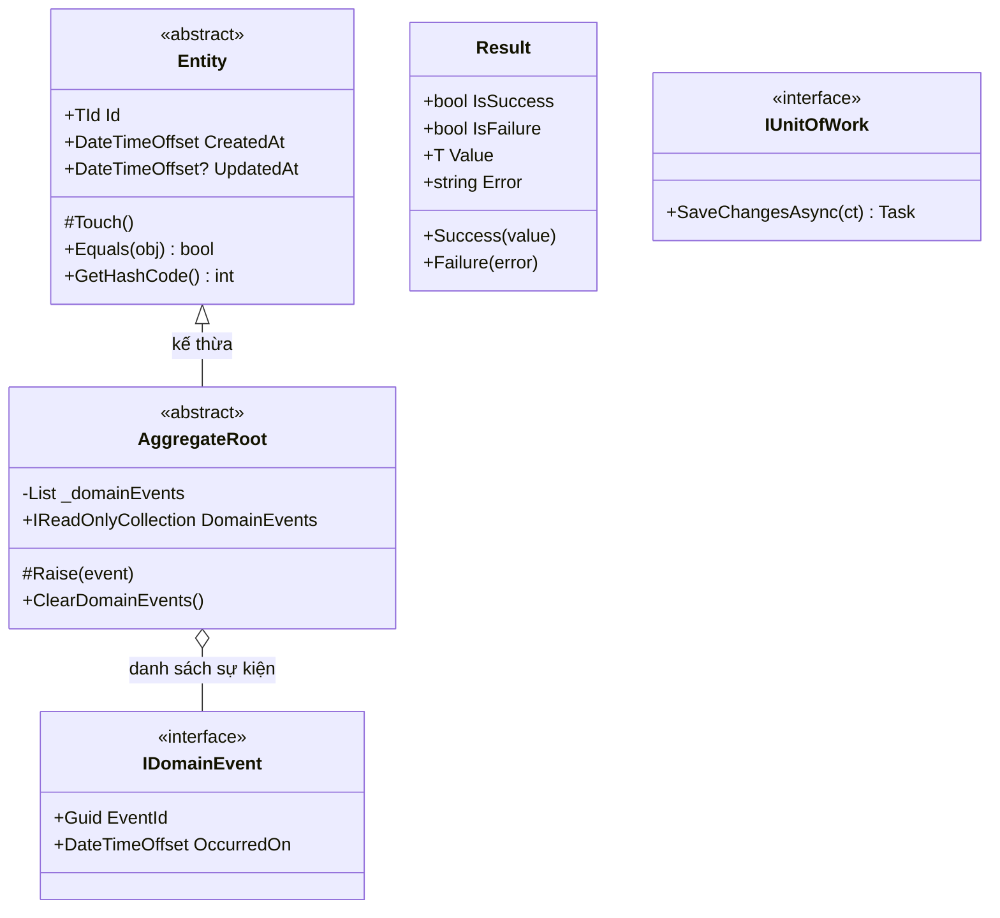
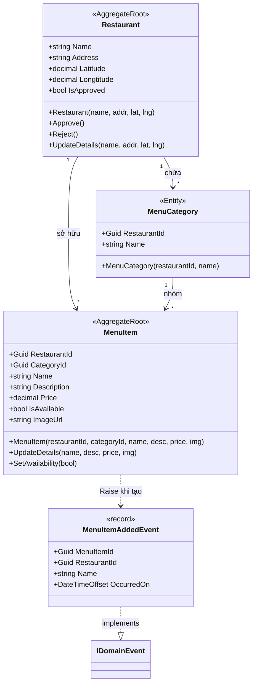
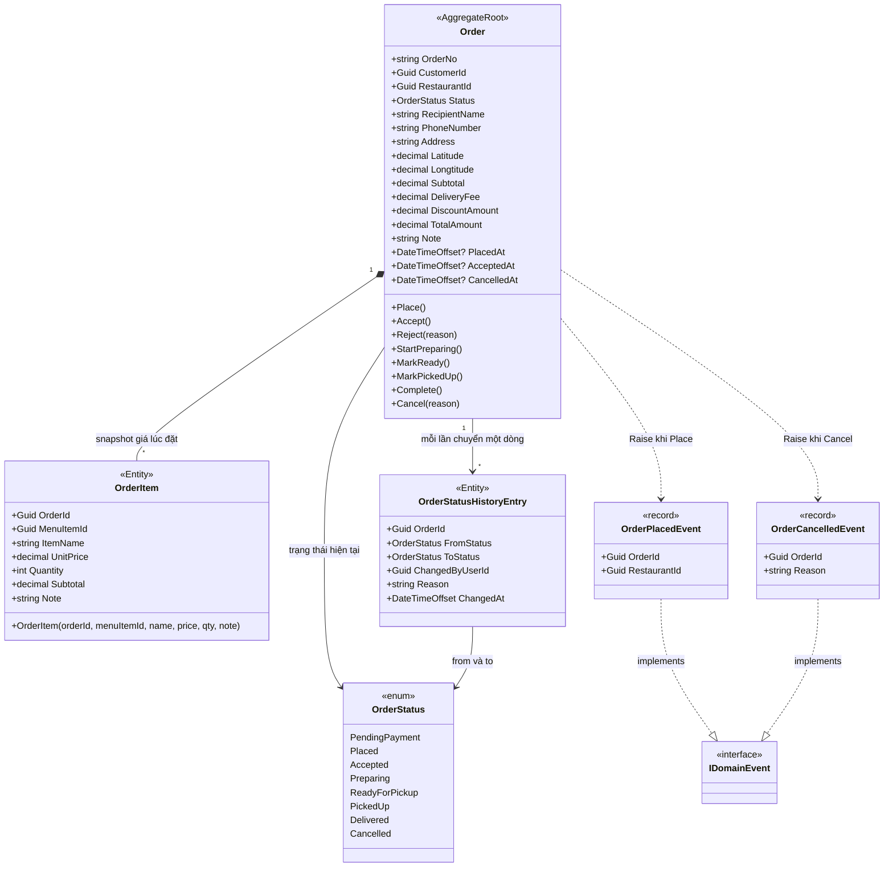
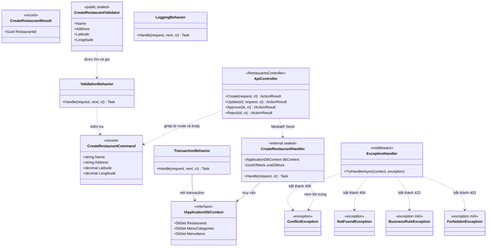
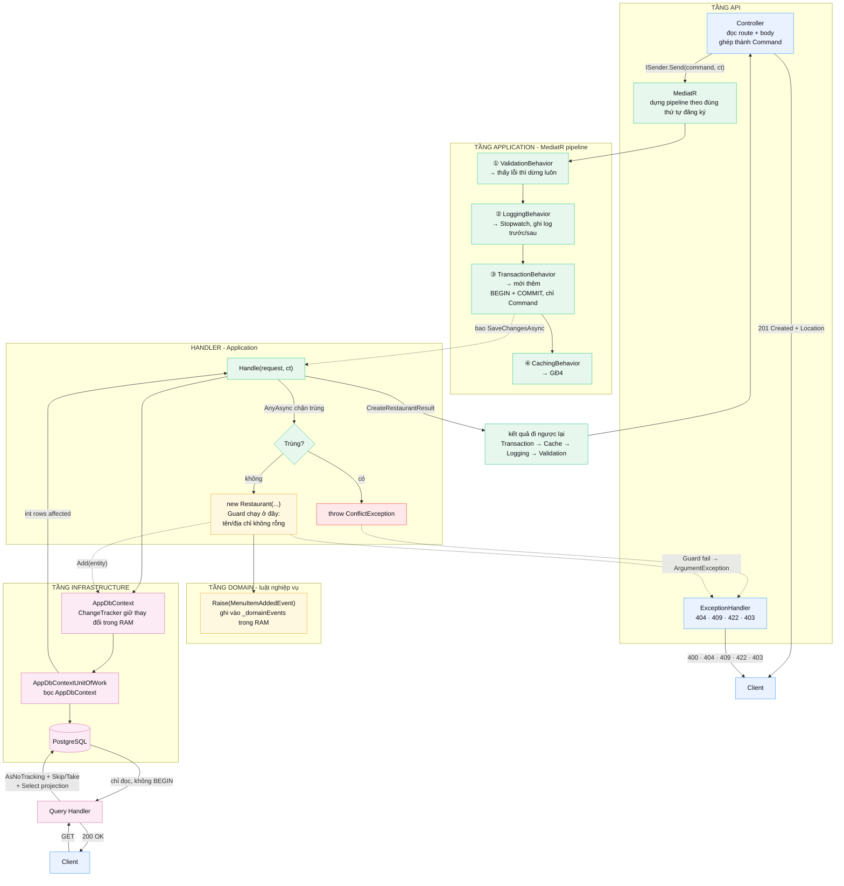
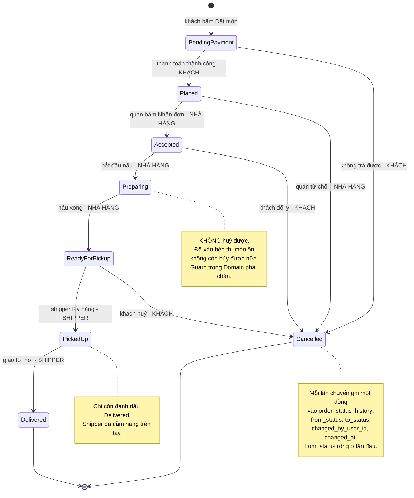
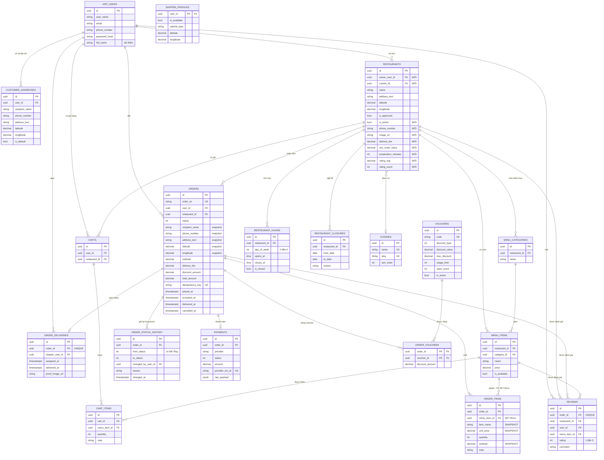

# FoodHub — Class diagram: từng lớp làm gì và ai gọi ai

Tài liệu này vẽ **cấu trúc lớp** của hệ thống: lớp nền tảng, Domain, pipeline CQRS,
luồng chạy thật của một request, state machine của đơn hàng, và sơ đồ quan hệ toàn bộ bảng.

Đọc theo thứ tự từ trên xuống — mỗi phần dựa vào phần trước.

> **Bản HTML có diễn giải chi tiết từng diagram**: `docs/CLASS-DIAGRAMS.html`
> **Kế hoạch triển khai kèm theo**: `docs/PLAN-SHOPEEFOOD.html`
> **Mã nguồn Mermaid**: `docs/diagrams/2*.mmd` · copy nguyên khối vào <https://mermaid.live> để xem trực tiếp.

---

## Mục lục

| Phần                                                   | Nội dung                                     | Diagram |
| ------------------------------------------------------ | -------------------------------------------- | ------- |
| [1](#phần-1--sharedkernel--4-lớp-nền)                  | SharedKernel — 4 lớp nền                     | `20`    |
| [2](#phần-2--domain-hiện-tại--restaurant-và-thực-đơn)  | Domain hiện tại — Restaurant / Menu          | `21`    |
| [3](#phần-3--order-aggregate--phần-sắp-viết)           | **Order aggregate — phần sắp viết**          | `22`    |
| [4](#phần-4--cqrs--command-handler-validator-behavior) | CQRS — Command, Handler, Validator, Behavior | `23`    |
| [5](#phần-5--luồng-chạy-thật-của-một-request)          | Luồng chạy thật của một request              | `24`    |
| [6](#phần-6--state-machine-của-đơn-hàng)               | State machine của đơn hàng                   | `25`    |
| [7](#phần-7--quan-hệ-18-bảng)                          | Quan hệ 18 bảng                              | `26`    |

---

# PHẦN 1 — SharedKernel: 4 lớp nền

Không thuộc domain nào cụ thể, dùng chung cho toàn hệ thống. Nếu không có tầng này,
mỗi module sẽ phải tự viết lại `Entity` và `IUnitOfWork` của riêng mình.

### Ba điều dễ nhầm ở tầng này

**1. `Equals` so sánh bằng `Id`, không so sánh thuộc tính.**
Hai `Restaurant` khác `Id` là hai đối tượng khác nhau kể cả khi tên và địa chỉ giống hệt —
đó là lý do `CreateRestaurantHandler` phải hỏi database thay vì so sánh trong RAM.

**2. `UpdatedAt` là `DateTimeOffset?` và chỉ có giá trị sau khi gọi `Touch()`.**
Nó được set trong ctor của `Restaurant` — vì vậy bảng cho phép `updated_at` NULL.
NULL nghĩa là _"chưa sửa lần nào"_, không phải lỗi. Sửa nó thành NOT NULL là mất thông tin.

**3. `ClearDomainEvents()` phải gọi sau khi `SaveChangesAsync` thành công.**
Gọi sớm thì mất sự kiện khi transaction rollback.

---

# PHẦN 2 — Domain hiện tại: Restaurant và thực đơn

### Vì sao MenuItem là AggregateRoot chứ không phải Entity

Vì nó cần `Raise()` để bắn `MenuItemAddedEvent`. Về mặt DDD cũng đúng: món ăn có vòng đời
độc lập và đổi rất thường xuyên — nếu gộp vào aggregate `Restaurant`, mỗi lần bật/tắt món
sẽ kéo theo việc nạp và kiểm soát toàn bộ thực đơn của nhà hàng.

### Còn thiếu trong diagram này

Không có mảnh nào chỉ ra **ai sở hữu nhà hàng**. Không có `owner_user_id`,
không có `cuisine_id`, không có giờ mở cửa. Đó chính là danh sách bổ sung ở
`PLAN-SHOPEEFOOD.html` §4.

---

# PHẦN 3 — Order aggregate: phần sắp viết

Đây là lớp khó nhất của cả app: 8 trạng thái, **3 vai trò khác nhau**, mỗi vai trò được
phép chuyển những trạng thái riêng. Hiện `TODO.md` mới chỉ ghi nó trong một dòng bullet.

### Ba cột không được bỏ: ItemName, UnitPrice, Subtotal

Chúng là **snapshot**. Nếu nhà hàng tăng giá món từ 30k lên 50k, đơn cũ **không được**
đổi theo — nếu không, hệ thống sẽ in ra tổng tiền sai cho một đơn đã giao xong
mà khách vẫn còn giữ.

Vì vậy `menu_item_id` được để **NULL** khi món bị xoá khỏi thực đơn
(`ON DELETE SET NULL`), chứ không phải xoá luôn dòng đơn.

### Guard trạng thái đặt trong Domain, không đặt trong Handler

Mỗi method chuyển trạng thái tự kiểm tra trạng thái hiện tại. Nếu không hợp lệ thì ném
`BusinessRuleException` → 422. Handler chỉ gọi `order.Cancel(reason)`, không tự kiểm tra
_"đơn có đang nấu không"_.

Lý do: có 8 endpoint chuyển trạng thái và một SignalR hub tự chuyển theo timeout.
Nếu rải điều kiện ra handler, sẽ có 10 chỗ phải giữ cho đúng. Để trong Domain thì
**một chỗ duy nhất, không thể bỏ sót**.

---

# PHẦN 4 — CQRS: Command, Handler, Validator, Behavior

### Validator phải public, Handler thì internal

`AddValidatorsFromAssembly()` mặc định `includeInternalTypes: false`.
Validator `internal` bị bỏ qua **im lặng** — vì `ValidationBehavior` làm
`if (validators.Any())`: không tìm thấy validator nào thì coi như hợp lệ.
Không có lỗi, không cảnh báo, chỉ có dữ liệu rác lọt vào DB.

Handler thì **được** `internal` vì MediatR tạo qua reflection.

---

# PHẦN 5 — Luồng chạy thật của một request

### Đường ghi và đường đọc khác nhau ở chỗ nào

**Command** đi qua `TransactionBehavior` mở `BEGIN`, rồi `SaveChangesAsync` đẩy xuống
PostgreSQL. **Query** không mở transaction — chỉ `SELECT` với
`AsNoTracking + Skip/Take + Select`. Đó là lý do `TransactionBehavior` **phải kiểm tra
Command hay Query** trước khi mở transaction.

### Cửa sổ tranh chấp nằm ở đâu

`AnyAsync` chặn trùng và `INSERT` là **hai câu lệnh riêng biệt**. Hai request song song
cùng chạy `AnyAsync` → cùng thấy _"chưa có"_ → cùng `INSERT`.
Chỉ unique index ở database mới đóng được lỗ hổng này.

---

# PHẦN 6 — State machine của đơn hàng

### Ai được chuyển trạng thái nào

| Vai trò      | Được chuyển sang                                       | Endpoint dự kiến                                                                   |
| ------------ | ------------------------------------------------------ | ---------------------------------------------------------------------------------- |
| **Khách**    | `Placed`, `Cancelled`                                  | `POST /api/orders` · `PATCH /api/orders/{id}/cancellation`                         |
| **Nhà hàng** | `Accepted`, `Cancelled`, `Preparing`, `ReadyForPickup` | `PATCH /api/orders/{id}/acceptance` · `/rejection` · `/preparation` · `/readiness` |
| **Shipper**  | `PickedUp`, `Delivered`                                | `PATCH /api/orders/{id}/pickup` · `/delivery`                                      |
| **Hệ thống** | `Cancelled`                                            | Job quét đơn quá hạn không ai nhận                                                 |

**Mỗi hàng trong bảng trên là một authorization requirement.** Khách gọi
`.../acceptance` phải bị từ chối 403. Nhà hàng gọi `.../delivery` cũng vậy. Đây là chỗ
`[Authorize]` + `owner_user_id` ở `restaurants` mới đủ sức phân biệt —
mà cả hai đều chưa có trong hệ thống.

---

# PHẦN 7 — Quan hệ 18 bảng

Ba bảng gốc hiện có (`restaurants`, `menu_categories`, `menu_items`) nằm ở phía trên;
15 bảng mới là phần còn lại.

---

## Ghi chú đọc diagram

| Ký hiệu             | Nghĩa                                |
| ------------------- | ------------------------------------ |
| `<<AggregateRoot>>` | Có `Raise()`, là ranh giới giao dịch |
| `<<Entity>>`        | Chỉ có `Id`, không bắn sự kiện       |
| `<<enum>>`          | Kiểu liệt kê                         |
| `+` / `-`           | public / private                     |
| `#`                 | protected                            |
| `-->`               | có quan hệ, hướng đọc                |
| `..>`               | phụ thuộc, không giữ tham chiếu      |
| `*--`               | thành phần, xoá chung                |
| `<\|--`             | kế thừa                              |

### Hai điều dễ hiểu sai trong sơ đồ ER

**1. Dòng `MENU_ITEMS ||--o{ ORDER_ITEMS` không giữ tính toàn vẹn.**
Cột `menu_item_id` trong `order_items` được khai `NULL` và FK là `SET NULL`.
Khi nhà hàng xoá món khỏi thực đơn, dòng đơn hàng vẫn còn nguyên, chỉ mất liên kết.
Đó là hệ quả trực tiếp của việc snapshot giá.

**2. `orders.user_id` và `orders.restaurant_id` là RESTRICT, không phải CASCADE.**
Xoá nhà hàng khi đã có đơn là mất lịch sử giao hàng — khách khiếu nại
thì không còn dữ liệu đối chiếu.
