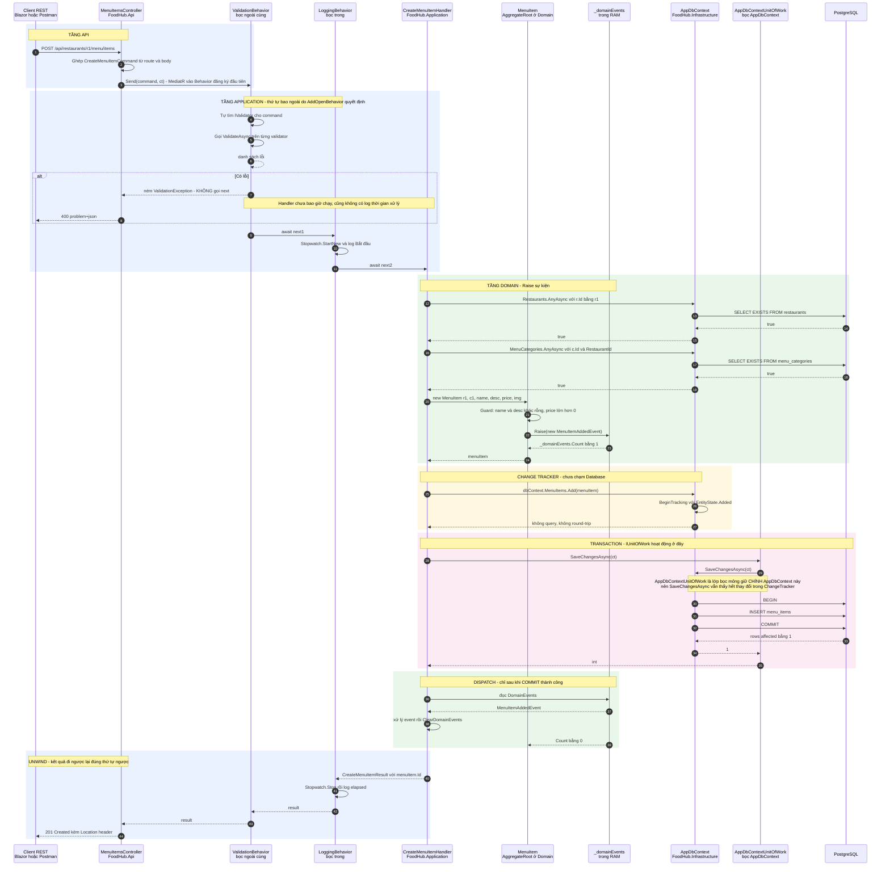
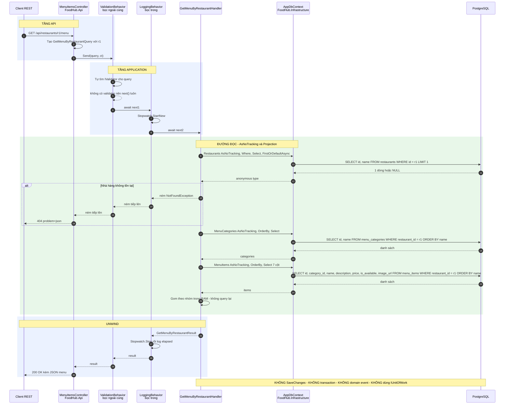
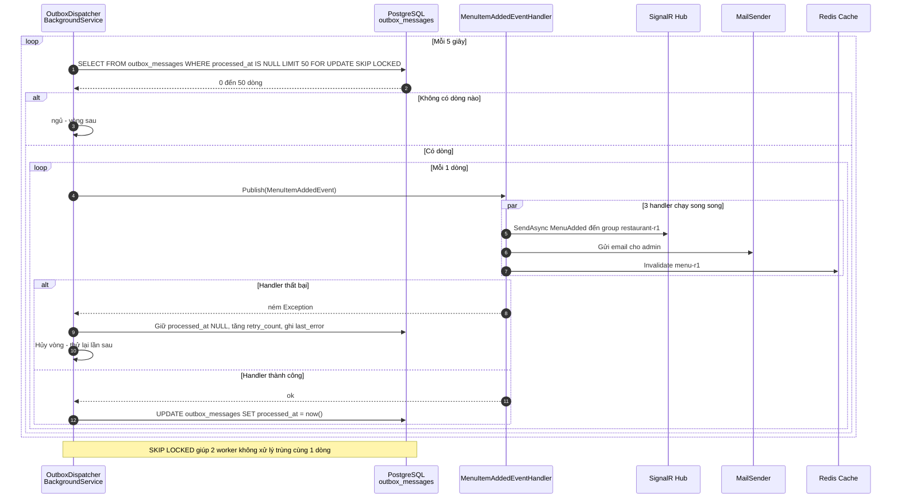

# FoodHub — Luồng xử lý Create / Update / Get, Domain Event và IUnitOfWork

Tài liệu này giải thích **đầy đủ** một request đi từ Client → Api → Application → Domain → Infrastructure → Database và quay lại, kèm cơ chế bắn sự kiện, xử lý sự kiện, và cách `IUnitOfWork` hoạt động.

## Cách dùng

- **Mã nguồn Mermaid**: `docs/diagrams/*.mmd`
- **Bản render SVG**: `docs/diagrams/rendered/*.svg`
- **Dán lên Mermaid Chart**: copy nguyên khối code ```mermaid trong file này vào <https://mermaid.live> hoặc Mermaid Chart editor.

> Số thứ tự trong diagram (`autonumber`) khớp với phần giải thích bên dưới từng bước.

---

## Sơ đồ tổng quan các tầng

```text
Client ──HTTP──▶ FoodHub.Api ──▶ FoodHub.Application ──▶ FoodHub.Domain
                                        │                      │
                                        │                      └── AggregateRoot
                                        │                           ├── Raise(IDomainEvent)
                                        │                           └── Raise ghi vào RAM
                                        ▼
                                 FoodHub.Infrastructure
                                        │
                                        ├── AppDbContext  (EF Core, ChangeTracker)
                                        ├── IUnitOfWork   (chính AppDbContext)
                                        └── PostgreSQL
```

Quy tắc phụ thuộc: `Api → Infrastructure → Application → Domain → SharedKernel`. Chiều đi xuống được, đi ngược lại thì không.

---

# PHẦN 1 — Diagram CREATE / UPDATE (đường ghi)

## 1.1 Mã Mermaid



## 1.2 Bảng đi từng file

| # | Bước trong diagram | File thực thi | Đoạn code |
|---|---|---|---|
| 1 | `POST /api/restaurants/r1/menu/items` | `src/FoodHub.Api/Controllers/MenuItems/MenuItemsController.cs` | `public async Task<ActionResult<CreateMenuItemResult>> Create(...)` |
| 2 | Ghép Command từ route + body | cùng file | `new CreateMenuItemCommand(restaurantId, request.CategoryId, request.Name, ...)` |
| 3 | `Send(command, ct)` | MediatR tự resolve, cấu hình tại `src/FoodHub.Application/DependencyInjection.cs` | `services.AddMediatR(cfg => { cfg.RegisterServicesFromAssembly(assembly); cfg.AddOpenBehavior(typeof(LoggingBehavior<,>)); cfg.AddOpenBehavior(typeof(ValidationBehavior<,>)); })` |
| 4 | `Stopwatch.StartNew()` | `src/FoodHub.Application/Behaviors/LoggingBehavior.cs` | `logger.LogInformation("Bắt đầu xử lý {RequestName}", requestName);` |
| 5 | `await next1` | cùng file | `var response = await next();` — `next` là `RequestHandlerDelegate<TResponse>`, tức delegate |
| 6 | `ValidateAsync(request)` | `src/FoodHub.Application/Behaviors/ValidationBehavior.cs` | `validators.Select(v => v.ValidateAsync(validationContext, ct))` |
| 7 | Rules kiểm tra | `src/FoodHub.Application/Restaurants/MenuItems/Commands/CreateMenuItem/CreateMenuItemValidator.cs` | `RuleFor(x => x.Price).GreaterThan(0)...` |
| 8 | Có lỗi → 400 | `src/FoodHub.Api/Middleware/ValidationExceptionHandler.cs` | `httpContext.Response.StatusCode = StatusCodes.Status400BadRequest;` |
| 9 | `await next2` | `ValidationBehavior.cs` | `return await next();` |
| 10 | `AnyAsync` kiểm tra nhà hàng | `src/FoodHub.Application/Restaurants/MenuItems/Commands/CreateMenuItem/CreateMenuItemHandler.cs` | `dbContext.Restaurants.AnyAsync(r => r.Id == request.RestaurantId, ct)` |
| 11 | Không tồn tại → 404 | `src/FoodHub.Api/Middleware/NotFoundExceptionHandler.cs` | `if (exception is not NotFoundException ...) return false;` |
| 12 | `new MenuItem(...)` | `src/FoodHub.Domain/Restaurants/MenuItem.cs` | constructor gọi `Raise(new MenuItemAddedEvent(...))` |
| 13 | Guard bất biến | cùng file | `ArgumentException.ThrowIfNullOrWhiteSpace(name); ArgumentOutOfRangeException.ThrowIfNegativeOrZero(price);` |
| 14 | `Raise(...)` | `src/BuildingBlocks/FoodHub.SharedKernel/AggregateRoot.cs` | `protected void Raise(IDomainEvent domainEvent) => _domainEvents.Add(domainEvent);` |
| 15 | `Add(menuItem)` | `CreateMenuItemHandler.cs` | `dbContext.MenuItems.Add(menuItem);` |
| 16 | `SaveChangesAsync(ct)` | `src/FoodHub.Domain/Persistence/IUnitOfWork.cs` (interface) → `src/FoodHub.Infrastructure/Persistence/AppDbContextUnitOfWork.cs` (hiện thực) | `=> dbContext.SaveChangesAsync(cancellationToken)` |
| 17 | `BEGIN ... COMMIT` | EF Core tự sinh | xem phần 3 bên dưới |
| 18 | `INSERT outbox_messages` | `src/FoodHub.Infrastructure/Persistence/Interceptors/OutboxInterceptor.cs` (Giai đoạn 2) | `context.SaveChangesInterceptor.SavingChangesAsync` → đọc `DomainEvents` |
| 19 | Đọc + Clear | `src/FoodHub.Infrastructure/Outbox/OutboxDispatcher.cs` (Giai đoạn 2) | `foreach (var e in aggregate.DomainEvents) ... aggregate.ClearDomainEvents();` |
| 20 | Unwind pipeline | `LoggingBehavior.cs` | `stopwatch.Stop(); logger.LogInformation("Xử lý xong trong {ElapsedMilliseconds} ms", ...)` |
| 21 | `201 Created` | `MenuItemsController.cs` | `return CreatedAtAction(nameof(Get), new { restaurantId }, result);` |

## 1.3 Giải thích chi tiết

### Bước 1–3: Api nhận request và giao cho MediatR

Controller **không** chứa logic nghiệp vụ. Nó làm đúng 2 việc:

```csharp
[HttpPost("items")]
public async Task<ActionResult<CreateMenuItemResult>> Create(
    Guid restaurantId,                              // từ ROUTE
    CreateMenuItemRequest request,                  // từ BODY
    CancellationToken cancellationToken)
{
    var command = new CreateMenuItemCommand(
        restaurantId,          // ghép route vào command
        request.CategoryId,
        request.Name,
        request.Description,
        request.Price,
        request.ImageUrl);

    var result = await sender.Send(command, cancellationToken);
    return CreatedAtAction(nameof(Get), new { restaurantId }, result);
}
```

**Tại sao phải có `CreateMenuItemRequest` riêng?** Nếu bind thẳng `CreateMenuItemCommand` từ body, client sẽ tự gửi `restaurantId` trong JSON và ghi đè giá trị trong route. Tách DTO ở tầng Api là ranh giới tin cậy: **route là thẩm quyền, body chỉ là dữ liệu**.

### Bước 4–9: Pipeline Behaviors — `next` chính là delegate

```csharp
// LoggingBehavior.cs
public async Task<TResponse> Handle(
    TRequest request,
    RequestHandlerDelegate<TResponse> next,      // ← DELEGATE: "hàm tiếp theo trong chuỗi"
    CancellationToken cancellationToken)
{
    var requestName = typeof(TRequest).Name;
    logger.LogInformation("Bắt đầu xử lý {RequestName}", requestName);

    var stopwatch = Stopwatch.StartNew();
    var response = await next();                  // ← gọi hàm tiếp theo
    stopwatch.Stop();

    logger.LogInformation("Xử lý {RequestName} xong trong {ElapsedMilliseconds} ms",
        requestName, stopwatch.ElapsedMilliseconds);

    return response;
}
```

Chuỗi thực thi được **nối ở runtime**, không ai viết `Logging` gọi `Validation` gọi `Handler` một cách cứng:

```text
sender.Send(command)
      │
      ▼
LoggingBehavior.Handle(request, next1)      next1 = ValidationBehavior.Handle
      │  await next1()
      ▼
ValidationBehavior.Handle(request, next2)   next2 = CreateMenuItemHandler.Handle
      │  await next2()
      ▼
CreateMenuItemHandler.Handle(command, ct)   ← handler thật
      │
      ▼
kết quả đi ngược lên (await hoàn tất)
```

Thêm Behavior mới chỉ cần thêm 1 dòng `cfg.AddOpenBehavior(typeof(...))` — không sửa code cũ. Đây chính là **Chain of Responsibility** dựng bằng delegate.

**Nhánh lỗi (bước 8)**: `ValidationBehavior` ném `ValidationException` **không gọi `next()`**. Chuỗi bị ngắt, handler không bao giờ chạy. Exception bay lên `Program.cs` → `app.UseExceptionHandler()` → `ValidationExceptionHandler` → trả 400 kèm danh sách lỗi tiếng Việt.

### Bước 10–11: Command cũng đọc được, nhưng đọc để kiểm tra

```csharp
var restaurantExists = await dbContext.Restaurants
    .AnyAsync(r => r.Id == request.RestaurantId, cancellationToken);

if (!restaurantExists)
    throw new NotFoundException($"nhà hàng {request.RestaurantId}.");
```

Đây là **SELECT**, không phải INSERT — nhưng nó nằm trong cùng lần gọi hệ thống. Không có transaction bao quanh ở giai đoạn này, vì chưa có gì để ghi. Transaction chỉ mở ở `SaveChangesAsync` (bước 17).

### Bước 12–14: `Raise` — bắn sự kiện

Đây là mấu chốt nhất. Xem `MenuItem` constructor:

```csharp
public MenuItem(Guid restaurantId, Guid categoryId, string name,
                string description, decimal price, string? imageUrl)
{
    ArgumentException.ThrowIfNullOrWhiteSpace(name);
    ArgumentException.ThrowIfNullOrWhiteSpace(description);
    ArgumentOutOfRangeException.ThrowIfNegativeOrZero(price);

    RestaurantId = restaurantId;
    CategoryId   = categoryId;
    Name         = name;
    // ...
    IsAvailable  = true;

    Raise(new MenuItemAddedEvent(Guid.NewGuid(), restaurantId, name));
}
```

Và trong `AggregateRoot`:

```csharp
protected void Raise(IDomainEvent domainEvent) => _domainEvents.Add(domainEvent);
```

**`Raise` không gửi gì đi cả.** Nó làm đúng một việc:

```text
_domainEvents.Add(e)
       │
       ▼
List<IDomainEvent> trong RAM:  [ MenuItemAddedEvent ]
```

- **Chưa** có SQL nào được sinh
- **Chưa** có email nào được gửi
- **Chưa** có SignalR nào được bắn
- Chỉ là ghi chú trong danh sách, nằm cùng đối tượng `menuItem` trong bộ nhớ

Tại sao phải vòng vo như vậy? Vì **gửi lệch thời gian là nguyên nhân mất dữ liệu**:

| Nếu gửi ngay trong Domain | Chuyện xảy ra |
|---|---|
| `signalR.SendAsync()` ở bước 14 | Nhà hàng đã thấy "có món mới" |
| Bước 17 `INSERT` thất bại | Transaction rollback, **món chưa tồn tại** |
| Kết quả | Nhà hàng thấy món không tồn tại, khách gọi món hết → bug không tái hiện được |

Ba nguyên tắc để tránh:

1. **Tách lúc phát sinh khỏi lúc gửi.** Domain chỉ ghi nhận, việc gửi thuộc tầng khác.
2. **Ghi sự kiện vào database cùng transaction với dữ liệu chính.** Đây là Outbox pattern.
3. **Chỉ đọc `DomainEvents` sau khi `COMMIT` thành công.** Trước đó mọi thứ có thể bị rollback.

**Ba tầng bảo vệ trong `AggregateRoot`:**

```text
private  _domainEvents   → không ai ngoài AggregateRoot đụng tới được
protected Raise(...)    → chỉ class con tự tạo event về chính mình
public    DomainEvents  → ai cũng đọc được (để gửi đi)
public    ClearDomainEvents() → chỉ dispatcher gọi, sau khi gửi xong
```

Vì sao `Raise` là `protected` chứ không phải `public`? Vì ngữ nghĩa: **mỗi aggregate chỉ được tự thông báo về chính mình**. Nếu là `public`, bất kỳ tầng nào cũng bịa được sự kiện giả, và `protected` cũng chặn luôn class khác nhét event vào — nguyên tắc "sự kiện phải bắt nguồn từ hành vi thật" được giữ bằng compiler.

### Bước 15: `Add()` chỉ ghi vào ChangeTracker

```csharp
dbContext.MenuItems.Add(menuItem);
```

`Add()` **không** gửi SQL. Nó chỉ đăng ký entity vào `ChangeTracker` (một bảng bản nhớ trong `AppDbContext`) với trạng thái `EntityState.Added`.

SQL thật sự chỉ được sinh ra ở `SaveChangesAsync`. Lợi ích:

- Gọi `Add()` 10 lần rồi `SaveChangesAsync()` 1 lần → **10 INSERT trong 1 transaction**, không phải 10 transaction.
- Nếu handler ném exception giữa chừng (trước `SaveChangesAsync`), **chưa có gì ghi vào DB** → miễn phí rollback.
- Có thể gọi `SaveChangesAsync()` nhiều lần trong cùng 1 transaction thủ công.

`menuItem.Id` đã có sẵn ngay từ constructor (`Guid.NewGuid()` trong `MenuItemAddedEvent`), nên lấy `Id` để trả về **không cần query lại**.

### Bước 16–17: `IUnitOfWork` hoạt động ở đây — xem phần 3

### Bước 18–19: Dispatcher — xem phần 4

---

# PHẦN 2 — Diagram GET (đường đọc)

## 2.1 Mã Mermaid



## 2.2 Bảng đi từng file

| # | Bước | File | Đoạn code |
|---|---|---|---|
| 1 | `GET /api/restaurants/r1/menu` | `src/FoodHub.Api/Controllers/MenuItems/MenuItemsController.cs` | `public async Task<ActionResult<GetMenuByRestaurantResult>> Get(Guid restaurantId, CancellationToken ct)` |
| 2 | Tạo Query | cùng file | `await sender.Send(new GetMenuByRestaurantQuery(restaurantId), ct)` |
| 3 | Pipeline | `LoggingBehavior.cs`, `ValidationBehavior.cs` | Query không có `IValidator` nên `validators.Any()` là false → `ValidationBehavior` pass-through |
| 4 | Query 1 | `src/FoodHub.Application/Restaurants/MenuItems/Queries/GetMenuByRestaurant/GetMenuByRestaurantHandler.cs` | `dbContext.Restaurants.AsNoTracking().Where(...).Select(r => new { r.Id, r.Name }).FirstOrDefaultAsync(ct)` |
| 5 | SQL sinh ra | EF Core dịch LINQ → SQL | `SELECT id, name FROM restaurants WHERE id = @p0 LIMIT 1` |
| 6 | Không có → 404 | `NotFoundExceptionHandler.cs` | trả 404 problem+json |
| 7–8 | Query 2 + 3 | `GetMenuByRestaurantHandler.cs` | 2 truy vấn `AsNoTracking()` |
| 9 | Gom nhóm trong RAM | cùng file | `items.Where(i => i.CategoryId == category.Id)...` |
| 10 | Unwind | `LoggingBehavior.cs` | log elapsed |
| 11 | `200 OK` | Controller | `return Ok(result);` |

## 2.3 So sánh đường đọc và đường ghi

| | Create / Update (ghi) | Get (đọc) |
|---|---|---|
| Loại | `IRequest<T>` trong `Commands/` | `IRequest<T>` trong `Queries/` |
| Đi qua Aggregate? | ✅ Có — tạo object, gọi method Domain | ❌ Không — đọc thẳng projection |
| `AsNoTracking()` | ❌ Không — **phải** track để EF biết đổi gì | ✅ Có — không cần track, tiết kiệm bộ nhớ |
| Cần `Entity` thật? | ✅ Có | ❌ Chỉ cần anonymous type hoặc DTO record |
| Có `Guard` bất biến? | ✅ Có | ❌ Không, vì không sửa gì |
| Có domain event? | ✅ Có `Raise` | ❌ Không có gì để thông báo |
| `IUnitOfWork`? | ✅ `SaveChangesAsync` | ❌ **Không dùng** |
| Transaction? | ✅ BEGIN/COMMIT tự động | ❌ Không, chỉ SELECT |
| Handler nhận | `IApplicationDbContext` + `IUnitOfWork` | chỉ `IApplicationDbContext` |
| Số câu SQL | INSERT | SELECT |

**Điểm cốt lõi của CQRS:** đường ghi đi qua Aggregate để bảo vệ tính nhất quán; đường đọc **né Aggregate hoàn toàn** vì không có gì cần nhất quán.

```csharp
// Đường đọc: cần 3 câu SQL cố định, không phụ thuộc số món
SELECT id, name FROM restaurants WHERE id = r1 LIMIT 1;
SELECT id, name FROM menu_categories WHERE restaurant_id = r1 ORDER BY name;
SELECT 7 cột FROM menu_items WHERE restaurant_id = r1 ORDER BY name;
```

Nếu viết kiểu nạp Aggregate rồi duyệt trong RAM, sẽ thành **N+1**: 1 câu lấy danh sách + 1 câu cho **từng** nhóm món. Với 50 nhóm món = 51 câu SQL. Cách hiện tại luôn là **2 câu**, bất kể bao nhiêu nhóm món.

---

# PHẦN 3 — `IUnitOfWork` hoạt động thế nào

## 3.1 Khai báo ở Domain, hiện thực ở Infrastructure

```csharp
// src/FoodHub.Domain/Persistence/IUnitOfWork.cs
// KHÔNG có using Microsoft.EntityFrameworkCore
namespace FoodHub.Domain.Persistence;

public interface IUnitOfWork
{
    Task<int> SaveChangesAsync(CancellationToken cancellationToken = default);
}
```

```csharp
// src/FoodHub.Infrastructure/Persistence/AppDbContextUnitOfWork.cs
namespace FoodHub.Infrastructure.Persistence;

public sealed class AppDbContextUnitOfWork(AppDbContext dbContext) : IUnitOfWork
{
    public Task<int> SaveChangesAsync(CancellationToken cancellationToken = default)
        => dbContext.SaveChangesAsync(cancellationToken);
}
```

Đây là mẫu **Dependency Inversion**: Domain định nghĩa *cái mình cần* (lưu thay đổi), Infrastructure hiện thực *cách thức* (EF Core). Domain không biết EF tồn tại, nên test Domain được mà không cần database.

## 3.2 Mấu chốt: cùng trỏ tới một `AppDbContext`

```csharp
// src/FoodHub.Infrastructure/DependencyInjection.cs
services.AddDbContext<AppDbContext>(options => options.UseNpgsql(connectionString));

services.AddScoped<IApplicationDbContext>(sp => sp.GetRequiredService<AppDbContext>());
services.AddScoped<IUnitOfWork>(sp => new AppDbContextUnitOfWork(sp.GetRequiredService<AppDbContext>()));
```

Đọc kỹ 2 dòng cuối — chúng **cố ý khác nhau**:

| Dòng | Vì sao viết thế |
|---|---|
| `IApplicationDbContext` | `AppDbContext` implement nó → trả thẳng `AppDbContext` |
| `IUnitOfWork` | `AppDbContext` **không** implement nó → phải bọc qua `AppDbContextUnitOfWork` |

**Vì sao không cho `AppDbContext` implement luôn `IUnitOfWork`?**

Nếu nó implement, khi tầng `Application` cần khai báo DI, bạn sẽ phải ghi kiểu cụ thể `AppDbContext` — một loại **thuộc Infrastructure**. Khi đó `Application` đã phụ thuộc ngược vào `Infrastructure`, phá vỡ ranh giới tầng. Lớp bọc giữ ranh giới: `Domain`/`Application` chỉ biết interface, chỉ `Infrastructure` biết `DbContext`.

```text
sp.GetRequiredService<AppDbContext>()   →  luôn trả về CÙNG MỘT AppDbContext trong scope hiện tại
```

`AddDbContext` đăng ký `AppDbContext` với lifetime mặc định là **Scoped**. Trong một HTTP request, DI container tạo **một** instance `AppDbContext` và dùng lại cho mọi lần resolve.

Kết quả:

```text
Handler có 2 tham số:

  IApplicationDbContext dbContext   ──resolve──▶  AppDbContext instance #A
  IUnitOfWork         unitOfWork   ──resolve──▶  AppDbContextUnitOfWork ──bọc──▶ AppDbContext #A

  ┌───────────────────────────────┐   ┌───────────────────────────────┐
  │  AppDbContext instance #A     │◀──┤  AppDbContextUnitOfWork      │
  │    ChangeTracker ─────────────┼───▶│  (chỉ giữ 1 tham chiếu)    │
  │    menuItem (Added)           │   └───────────────────────────────┘
  └───────────────────────────────┘
```

Nếu 2 interface trỏ tới **2 `AppDbContext` khác nhau**, đoạn này sẽ không hoạt động:

```csharp
dbContext.MenuItems.Add(menuItem);        // ghi vào ChangeTracker của instance #A
unitOfWork.SaveChangesAsync();            // instance #B không biết gì về menuItem
// → 0 dòng được INSERT, không có lỗi, không có cảnh báo. Rất khó phát hiện.
```

Đây là lý do phải dùng `GetRequiredService<AppDbContext>()` chứ không phải `new AppDbContext(...)` hay `AddDbContext` lần nữa.

**Scoped = 1 instance cho mỗi request.** Nhờ vậy mọi thao tác trong cùng 1 request đều dùng chung 1 `ChangeTracker`, và `ChangeTracker` được đặt lại tự động khi request kết thúc — không rò rỉ sang request sau.

## 3.3 Transaction tự động

EF Core mặc định **bọc toàn bộ lệnh SQL của một lần `SaveChangesAsync` trong một transaction**:

```text
SaveChangesAsync()
      │
      ├── EF phân tích ChangeTracker, sinh SQL cho mọi entity Added/Modified/Deleted
      ├── Nhận diện thứ tự để không vi phạm foreign key
      │
      ├──► BEGIN              ─┐
      │   INSERT menu_items    │ tất cả trong
      │   INSERT outbox_messages│ CÙNG 1 giao dịch
      │   COMMIT             ─┘
      │
      └── trả về số dòng bị ảnh hưởng
```

Nếu bất kỳ lệnh nào ném exception → `ROLLBACK` → **không có gì được ghi**. Đây là tính nguyên tử (atomicity).

### Khi nào cần `BeginTransactionAsync` thủ công?

Khi cần **nhiều lần `SaveChangesAsync` trong một transaction**:

```csharp
await using var tx = await dbContext.Database.BeginTransactionAsync(ct);
try
{
    await unitOfWork.SaveChangesAsync(ct);
    await auditUnitOfWork.SaveChangesAsync(ct);   // DbContext thứ hai
    await tx.CommitAsync(ct);
}
catch
{
    await tx.RollbackAsync(ct);
    throw;
}
```

Trong `PlaceOrder` (Giai đoạn 2) bạn sẽ cần điều này: ghi `Orders` + `OrderItems` + trừ kho, rồi mới cập nhật trạng thái nhà hàng.

## 3.4 Vì sao `Add()` trước, `SaveChangesAsync()` sau?

```csharp
dbContext.MenuItems.Add(menuItem);            // bước 15 — chỉ ghi vào RAM
// ... thêm code khác, gọi thêm Add() nữa ...
await unitOfWork.SaveChangesAsync(ct);        // bước 16 — mới động vào DB
```

| Lợi ích | Giải thích |
|---|---|
| Gom nhiều thay đổi | 10 lần `Add()` → 1 transaction, 10 INSERT |
| Miễn phí khi lỗi | Handler ném exception trước `SaveChangesAsync` → DB không bị đụng tới |
| Id sẵn có | Sinh ở Domain, không cần `SELECT` lại sau insert |
| Điều kiện ghi | Có thể quyết định `Add` hay `Update` hay bỏ qua dựa trên dữ liệu đọc được trước đó |

## 3.5 UPDATE khác CREATE ở chỗ nào

CREATE dùng `Add()` (entity mới, `EntityState.Added`). UPDATE phải **nạp entity thật lên** trước:

```csharp
// src/FoodHub.Application/.../Commands/UpdateMenuItem/UpdateMenuItemHandler.cs
var menuItem = await dbContext.MenuItems
    .FirstOrDefaultAsync(i => i.Id == request.MenuItemId, ct);   // phải có AsTracking

if (menuItem is null)
    throw new NotFoundException($"món ăn {request.MenuItemId}.");

menuItem.UpdateDetails(request.Name, request.Description, request.Price, request.ImageUrl);

await unitOfWork.SaveChangesAsync(ct);
```

```text
FirstOrDefaultAsync     SELECT ... → nạp entity, EF tự đánh dấu EntityState.Unchanged
UpdateDetails(...)      đổi giá trị property → EF **so sánh snapshot cũ** phát hiện khác biệt
SaveChangesAsync()      EF sinh UPDATE menu_items SET name=@p0, description=@p1, ...
                         + updated_at = now()   ← do Touch() trong Domain gọi
```

Vì sao phải nạp entity thật? Vì:

1. `private set` — code bên ngoài không gán được property, phải qua method Domain.
2. Method Domain có `Guard` bất biến: `ArgumentOutOfRangeException.ThrowIfNegativeOrZero(price)`.
3. Nguyên tắc **optimistic concurrency**: `RowVersion` (đã có trong thiết kế `Orders` của roadmap) để phát hiện hai người sửa cùng một bản ghi.

Lỗi kinh điển nếu không nạp entity: gọi `Update(entity)` với object rỗng → EF sinh UPDATE ghi đè **toàn bộ** các cột bằng giá trị mặc định, xoá sạch dữ liệu cũ.

---

# PHẦN 4 — Domain Event: bắn ra và xử lý thế nào

## 4.1 Ba giai đoạn

```text
GIAI ĐOẠN 1 — Ghi vào RAM (đồng bộ, trong Domain)
──────────────────────────────────────────────────
new MenuItem(...)
   └─► Raise(new MenuItemAddedEvent(...))
          └─► _domainEvents.Add(e)

   → Chưa có SQL. Chưa gửi gì. Chỉ là ghi chú trong RAM.

              │  SaveChangesAsync
              ▼
GIAI ĐOẠN 2 — Ghi vào bảng outbox_messages (cùng transaction)
───────────────────────────────────────────────────────────────
BEGIN
  INSERT menu_items
  INSERT outbox_messages (id, type, payload, processed_at = NULL)
COMMIT

   → Sự kiện đã BỀN VỮNG. App chết cũng không mất.

              │  Worker chạy nền, mỗi 5 giây
              ▼
GIAI ĐOẠN 3 — Worker đọc bảng và gửi đi
─────────────────────────────────────────
SELECT * FROM outbox_messages WHERE processed_at IS NULL LIMIT 50
   ├─► SignalR.SendAsync cho nhà hàng
   ├─► MailKit gửi email
   └─► Redis Invalidate cache
UPDATE outbox_messages SET processed_at = now()
```

## 4.2 Tại sao phải 3 giai đoạn, không gộp làm 1

| Gộp vào | Vấn đề |
|---|---|
| Giai đoạn 1 (gửi ngay trong Domain) | Transaction rollback nhưng email đã bay. Domain còn bị dính SignalR → phá Clean Architecture |
| Giai đoạn 2 (gửi ngay trong transaction) | Transaction rollback không hoàn tác được email/SignalR đã gửi. Vẫn mất sự kiện |
| Chỉ giai đoạn 1, không có bảng | App restart là mất sạch event trong RAM. Không retry được |

Ba giai đoạn giải quyết cả ba:

- **Giai đoạn 1 tách Domain khỏi hạ tầng** → Domain không biết email/SignalR là gì.
- **Giai đoạn 2 đảm bảo atomic** → event và dữ liệu chính cùng thành công hoặc cùng thất bại.
- **Giai đoạn 3 đảm bảo bền vững** → `processed_at IS NULL` là việc còn dở. Worker lần sau xử lý tiếp. Handler lỗi thì tăng `retry_count`, không mất.

## 4.3 `ClearDomainEvents` quan trọng thế nào

```csharp
// Nếu KHÔNG có ClearDomainEvents:
while (true)
{
    foreach (var e in order.DomainEvents)   // vòng 1 (giây 0): gửi
        dispatcher.Handle(e);

    await Task.Delay(5000);                 // vòng 2 (giây 5): GỬI LẠI Y HỆT
}
```

Khách nhận email xác nhận đơn liên tục, mỗi 5 giây một lần, không bao giờ dừng.

Với Outbox pattern nghiêm túc thì worker đọc từ **bảng** nên không dính lỗi này. Nhưng trong lúc chuyển tiếp, hoặc khi bạn thêm in-memory dispatcher để test, `ClearDomainEvents()` là hàng rào bắt buộc. Bỏ nó là bùng một loại bug khó tái hiện.

## 4.4 Diagram Outbox Worker (Giai đoạn 2)



### `FOR UPDATE SKIP LOCKED` là gì?

Khi chạy nhiều instance API (đã bật Redis backplane theo roadmap mục 6), sẽ có nhiều worker cùng đọc bảng `outbox_messages`.

- `FOR UPDATE` → khoá dòng lấy ra, chặn worker khác đọc dòng đó.
- `SKIP LOCKED` → worker thứ hai **bỏ qua** dòng đang bị khoá, đi xử lý dòng khác.

Không có nó: cả 2 worker đọc cùng dòng → gửi email trùng. Có nó: mỗi dòng chỉ 1 worker xử lý.

### Nhánh handler thất bại

```text
Handler ném Exception
      │
      ├── KHÔNG đánh dấu processed_at  → lần chạy sau thử lại
      ├── tăng retry_count              → đủ số lần thì bỏ qua và ghi cảnh báo
      └── ghi last_error                → để debug
```

Đây là **at-least-once delivery** (giao ít nhất một lần). Hệ quả: handler phải **idempotent** — gửi email hai lần thì không được. Roadmap mục 3 nhắc đúng điều này cho thanh toán: IPN có thể gọi nhiều lần, chỉ xử lý một lần.

---

# PHẦN 5 — Danh sách file liên quan

```text
src/
├── BuildingBlocks/FoodHub.SharedKernel/
│   ├── IDomainEvent.cs                      interface, không biết gì về Domain cụ thể
│   ├── Entity.cs                            định danh bằng Id
│   ├── AggregateRoot.cs                     Raise + DomainEvents + ClearDomainEvents
│   └── Result.cs                            kết quả có lý do thất bại
│
├── FoodHub.Domain/
│   ├── Persistence/IUnitOfWork.cs           chỉ interface, KHÔNG using EFCore
│   └── Restaurants/
│       ├── Restaurant.cs                    AggregateRoot
│       ├── MenuCategory.cs                  Entity
│       ├── MenuItem.cs                      AggregateRoot — gọi Raise trong constructor
│       └── MenuItemAddedEvent.cs            record : IDomainEvent
│
├── FoodHub.Application/
│   ├── Abstractions/
│   │   ├── IApplicationDbContext.cs         DbSet cho query + Add()
│   │   └── NotFoundException.cs             lỗi nghiệp vụ
│   ├── Behaviors/
│   │   ├── LoggingBehavior.cs               delegate next là xương sống của pipeline
│   │   └── ValidationBehavior.cs            chặn trước khi vào handler
│   ├── DependencyInjection.cs               AddMediatR + AddOpenBehavior + AddValidatorsFromAssembly
│   └── Restaurants/MenuItems/
│       ├── Commands/CreateMenuItem/         Command.cs + Handler.cs + Validator.cs
│       ├── Commands/UpdateMenuItem/         nạp entity → UpdateDetails → SaveChanges
│       ├── Commands/SetMenuItemAvailability/
│       └── Queries/GetMenuByRestaurant/     AsNoTracking + projection
│
├── FoodHub.Infrastructure/
│   ├── DependencyInjection.cs               AddDbContext + đăng ký CÙNG 1 instance
│   └── Persistence/
│       ├── AppDbContext.cs                  ChangeTracker
│       ├── AppDbContextUnitOfWork.cs        hiện thực IUnitOfWork
│       ├── IDesignTimeDbContextFactory.cs   cho dotnet ef
│       └── Configurations/                  3 file map bảng
│
└── FoodHub.Api/
    ├── Program.cs                           AddApplication + AddInfrastructure + UseExceptionHandler
    ├── Controllers/MenuItems/MenuItemsController.cs
    └── Middleware/
        ├── NotFoundExceptionHandler.cs      404 problem+json
        └── ValidationExceptionHandler.cs    400 problem+json
```

# PHẦN 6 — Bảng đối chiếu nhanh

| Câu hỏi | Trả lời |
|---|---|
| `Raise` gửi email không? | Không. Chỉ `_domainEvents.Add()` trong RAM |
| Ai gọi `Raise`? | Chỉ class con của `AggregateRoot`, qua `protected` |
| Ai đọc `DomainEvents`? | Ai cũng đọc được (`public IReadOnlyCollection<T>`) |
| Khi nào đọc `DomainEvents`? | Sau khi `COMMIT` thành công |
| `ClearDomainEvents` gọi lúc nào? | Sau khi dispatch xong, chống gửi trùng |
| `IUnitOfWork` ở đâu? | Interface ở Domain, hiện thực ở Infrastructure |
| `IUnitOfWork` và `AppDbContext` có phải 2 object? | **Không** — cùng 1 instance trong scope |
| `Add()` có INSERT chưa? | Chưa. Chỉ đăng ký vào ChangeTracker |
| Transaction mở khi nào? | Bên trong `SaveChangesAsync`, tự động |
| Query có cần `IUnitOfWork`? | Không |
| Query có đi qua Aggregate? | Không — đọc thẳng projection |
| `UPDATE` khác `CREATE` thế nào? | Phải `FirstOrDefaultAsync` nạp entity thật rồi gọi method Domain |
| Handler thất bại thì sao? | `ROLLBACK` toàn bộ, không có gì ghi |
| Worker chạy song song được? | Có, nhờ `FOR UPDATE SKIP LOCKED` |
| Giao hàng là gì? | At-least-once → handler phải idempotent |

# Tài liệu liên quan

- `Roadmap.md` — mục 3 (nghiệp vụ nâng cao), mục 6 (điểm kỹ thuật), mục 9 (lỗi dễ mắc)
- `SETUP-BUOC-4-10.md` — hướng dẫn dựng code từng bước
